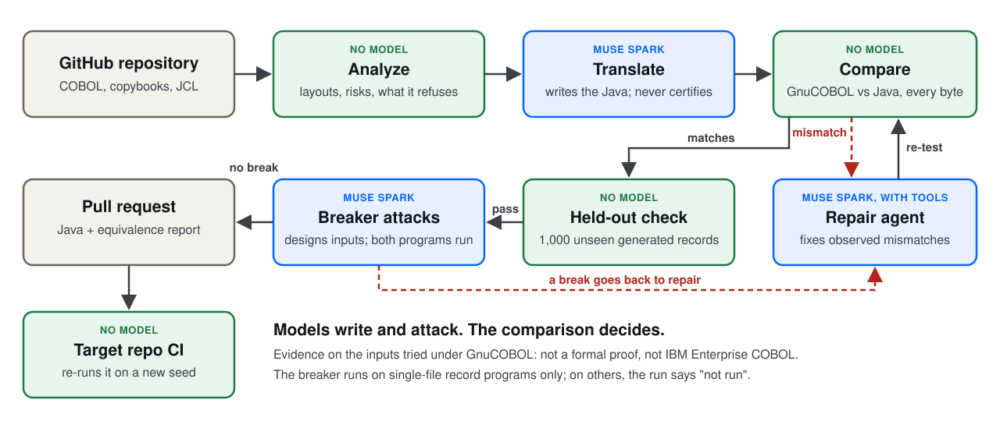
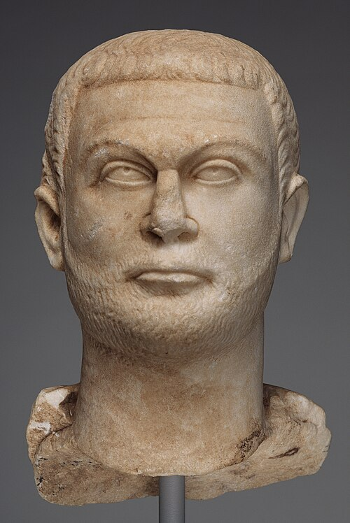

**Demo video (under 3 min): https://youtu.be/C-sXQnX6uJ0**

Narration: a synthetic voice (ElevenLabs), not a Meta model and not part of the product.

<p align="center"></p>

# Diocle

[](https://github.com/Nivetha200111/Diocle/actions/workflows/test.yml)

**AI writes the code. Diocle checks it against the original, and then attacks it, before anyone has to trust it.**

| Start here | |
|---|---|
| **Watch** | [The demo video](https://youtu.be/C-sXQnX6uJ0) |
| **Try** | [diocle.vercel.app](https://diocle.vercel.app): press **Try the sample** to re-check stored Java on fresh records (free, no model) |
| **See** | [Every feature, with screenshots](docs/WALKTHROUGH.md), including VS Code and Muse Code |
| **Check** | [One run end to end](docs/SHOWCASE_CHQCLR.md), [the measurement](docs/MEASUREMENT.md), [a public repository we did not write](docs/EXTERNAL_ESTATE.md#conversion-phase-nov-2-to-3-2026-mac), [a blind test on code no fix had seen](docs/BLIND_TEST.md), [each claim and how to verify it](docs/CLAIMS_TO_EVIDENCE.md), [a delivered pull request](https://github.com/Nivetha200111/quillmark-modern/pull/4) and [its CI run](https://github.com/Nivetha200111/quillmark-modern/actions/runs/40811476870), [the build log](docs/BUILD_LOG.md) |
| **Everything else** | [The full reference](docs/DETAILS.md) |

<p>
  <a href="https://www.meta.ai"></a>&nbsp;&nbsp;
  <a href="https://fireworks.ai"></a>&nbsp;&nbsp;
  <a href="https://www.baseten.co"></a>
</p>

<sub>Built with <strong>Meta</strong>'s models. <strong>Fireworks</strong> and <strong>Baseten</strong> host the open-weights Muse Spark Open. Logos belong to their owners and identify what Diocle uses; no endorsement or partnership is implied.</sub>

**Meta Global AI Developer Hackathon entry:** Indie Developer track, problem statement **Build for Your World**: a problem the author knows firsthand, large COBOL modernization projects.

**Built during the hackathon, Oct 27 to Nov 4, 2026:** all of Diocle's own code, docs and synthetic samples; the first commit is dated Oct 27. Pre-existing and used: GnuCOBOL, the JDK, Berkeley DB, SQLite, web frameworks, Meta's models, and public COBOL repositories used as test input, not vendored, with short excerpts in published patches ([detail and licences](docs/HACKATHON_COMPLIANCE.md)).

**Meta models at runtime:** Muse Spark (Meta Model API) as translator, tool-using repair agent and breaker, by default and in the measurement. Muse Spark Open (Fireworks, Baseten) for optional private mode, which moves the agents to open weights, and is thinly tested: 11 public runs with no Muse Spark call, 6 reaching all three roles, 6 certified, none from a site visitor. It also writes the optional guard review after a run certifies on the live engine, unless a dollar cap stops it first. Muse Wonder reads a printed listing (one listing so far). Muse Voice Transcribe transcribes spoken questions. Muse Image can draw one small part of an import's [dependency tree](docs/DEPENDENCY_TREES.md), which Muse Wonder reads back and code checks: optional, capped, and off unless the server sets `TREE_IMAGE_MODEL_ID`. Offline, in recorded runs and not on the live engine: Muse Wonder and Muse Spark Open attacked Java in [Meta vs Meta](docs/META_TOURNAMENT.md), and Muse Image drew the recorded trees.

**For the bonus categories:** Best Agentic Use-Case (the repair agent and the breaker) and Best Build on Meta Open Weight Models (private mode on partner inference; optional and thinly tested, with Muse Spark as the default).

- **Why it's hard:** COBOL batch programs calculate interest, fees and postings, so one small difference repeats on every record that hits it. Java can compile, run and still differ.
- **One catch:** on a synthetic returned cheque with a space in its fee field, the COBOL charged `20.00` and the AI's Java charged `0.00`. The repair agent fixed that difference in that run, but that Java still differs on another malformed record, and this program certified in only 4 of 7 runs. The record is malformed, and this is GnuCOBOL, not IBM's compiler.
- **Measured:** on 15 synthetic programs, 4 of the 10 attackable translations that passed 1,000 generated records then differed from the original under attack: 1 on malformed numbers, 3 on the sign of a zero at an overflow boundary (same value, different bytes). No stored break shows a wrong amount on a well-formed record, and this is not a defect-detection rate.
- **On code we didn't write:** every program in a public COBOL course. 11 of 32 certified at first (9 on fixed input, 2 against a repaired copy). 13 ran and did not certify; the other 8 were refused, did not compile or were duplicates. After a fix that those failures prompted, a third pass, not a blind test, certified 9 of the 13 (8 against a repaired copy, 1 on fixed input).
- **On outside COBOL, blind:** the COBOL sources in the public repository of [Norway's retired national pension system](docs/BLIND_TEST.md) (`navikt/DSF`, MIT), most of which is PL/I. Whether these programs ran in production is not established. 2 of the 4 Diocle could test certified with no patch to the COBOL, after the repair agent fixed the first Java, and 2 did not. They are small programs on generated inputs, varying 1 of 7 and 6 of 10 input fields, with no breaker. Separately, `fzn0x/core-banking-system` certified 0 of 2 and `ibmdbbdev/Samples` only 11 very small programs. These repositories were chosen because the analyzer could test them; blind means only that no fix or tuning was made for them.

Diocle helps a modernization lead decide whether to accept AI-written Java for a COBOL batch program. Muse Spark translates the COBOL. The original, compiled with GnuCOBOL, runs next to the Java on the same inputs, and every output byte, display line and exit code must match. Java that passes is then attacked with inputs Muse Spark designs, and what differs goes back for repair. **A model never certifies; the comparison does.** The result is reproducible evidence on the inputs tried under GnuCOBOL: not a formal proof, and not a test on IBM Enterprise COBOL. Indie track, *Build for Your World*. Built Oct 27 to Nov 4, 2026; the measurement's programs are synthetic.

<p align="center"></p>

## Why it matters

A failed migration is expensive: TSB's 2018 core-banking migration affected a significant portion of its 5.2 million customers, cost the bank £330 million and brought a £48.65 million fine ([ITPro](https://www.itpro.com/business-strategy/it-infrastructure/369753/tsb-bank-fined-48-million-over-botched-it-upgrade)). AI makes the rewrite fast, not safe: Java can compile, run and still differ on some records. In February 2026, after Anthropic said AI could modernize COBOL, IBM's shares fell 13.2% in a day ([Reuters via The Star](https://www.thestar.com.my/tech/tech-news/2026/02/24/ibm-posts-steepest-daily-drop-since-2000-after-anthropic-says-ai-can-modernize-cobol)), and an IBM spokesperson answered that "translating COBOL is the easy part" ([VentureBeat](https://venturebeat.com/technology/ibms-usd40b-stock-wipeout-is-built-on-a-misconception-translating-cobol-isnt)). Showing that the translation does what the original did is the hard part, and it's the part Diocle does, on the inputs it tries.

**Who benefits:** the modernization lead or integrator deciding whether to accept AI-written Java; credit unions and small banks with no budget for mainframe experts to re-check every cent; and benefit, pension and insurance payment operators, whose batch programs pay real people. [More on who it's for](docs/DETAILS.md#who-benefits).

## Why I built this

I worked on a COBOL modernization at a global finance company, where every translated program was checked by hand, and it drained the project's timeline. Many of my colleagues were COBOL developers. They retired, and their work landed on junior engineers, who had to learn COBOL and verify it against the Java. AI now writes the Java in minutes, but someone still has to decide whether to accept it. I built the check I wished that project had. No code or data from that work is here.

## What we found

**Of 10 attackable AI translations that passed a held-out check of 1,000 generated records, the breaker made 4 differ from the original.** By the stored records, the differences are malformed numeric fields and the sign of a zero at an exact overflow boundary (same value, different bytes); no stored break shows a wrong amount on a well-formed record. Wrong amounts do occur in first translations, where the ordinary check catches them. A random test cannot reach those inputs, which is why the attack exists.

We then found two flaws in our own instrument, fixed them, and [re-measured on Nov 2](docs/MEASUREMENT.md#re-measurement-results-nov-2-2026-reported-as-planned-no-program-was-re-run) under a plan written first: **4 of 10 again, the same four programs.** Separately, full Diocle runs certified 14 of 15 programs (a different count: one run per program, with repair). That is 15 synthetic programs and one model, about $0.87 of model spend for both measurements. It is not a defect-detection rate, and the breaker does not find everything.

On one [synthetic cheque-clearing run](docs/SHOWCASE_CHQCLR.md), Muse Spark designed a returned cheque with a space in its numeric fee. The COBOL on GnuCOBOL charged `20.00`, the Java `0.00`. The repair agent fixed it, and it matched again on fresh records. That record is malformed, and IBM's compiler was not tested. Auditing our own evidence also found that the check gave that program near-identical records, and that this certified Java still differs on another malformed record. Both are published.

**On code we did not write:** [AWS CardDemo's `CBCUS01C`](docs/DETAILS.md#one-public-program-not-ours-carddemos-cbcus01c) certified for $0.0112, but it is a small reader: only 5 of 40 seeded faults were detected, and the breaker could not run on it. A recorded live import of CardDemo: 3 small readers certified in 6m 58s for an estimated $0.0355, with the same limits, while Diocle refuses 40 of its 44 programs, mostly CICS.

**Every program in a public course repository:** [32 programs from the Open Mainframe Project's COBOL course](docs/EXTERNAL_ESTATE.md#conversion-phase-nov-2-to-3-2026-mac), three dated passes, $2.07 of model spend. The first two certified 11: 9 as distributed but on fixed input, and 2 against a repaired copy whose patch is published. Of the 13 not certified, 11 use `WRITE ... AFTER ADVANCING`. GnuCOBOL writes the advancing into the file as bytes, and our verifier refused even identical Java while our prompts had no rule for it. After fixing both, [a third pass](docs/EXTERNAL_ESTATE.md#third-pass-results-nov-3-2026-mac), **not a blind test** because the fix answered this same course's failures, certified 9 of those 13: 8 against a repaired copy, and 1 as distributed on fixed input. That leaves 3 not certified and 1 whose original never ends, plus 3 that could not be patched to compile, 4 refused and 1 not converted. The two earlier passes stand as recorded. No program was certified as distributed on inputs that vary, the repaired copies vary 2 of 10 input fields, and these are small teaching programs, so this does not show Diocle works on any repository. Source: the course's authors, [CC BY 4.0](https://creativecommons.org/licenses/by/4.0/); the published patches reproduce short excerpts.

## Important features

| Feature | What it does | Models |
|---|---|---|
| **Compare** | Original on GnuCOBOL and Java on the same records, byte for byte | None |
| **Translate** | COBOL and copybooks to Java; never certifies | Muse Spark |
| **Breaker** | Designs inputs aimed at Java that passed, on single-file record programs | Muse Spark; Muse Wonder and Muse Spark Open in Meta vs Meta |
| **Repair agent** | Fixes observed mismatches with 7 tools; re-checked on unseen records | Muse Spark |
| **Delivery** | A pull request with a report per program, and CI that re-runs the comparison | None |
| **Copybooks as SQL** | Tables from the PICs, checked by a SQLite round trip | None |
| **Private mode, cross-check, guard** | Agents on open weights, plus an optional second attacker and review; thinly tested | Muse Spark Open on Fireworks and Baseten |
| **Meta vs Meta** | Three models attack the same Java, on 10 synthetic programs, once each: broke 4, 2 and 5. Only one model broke `PKDPOST`. [Not a ranking](docs/META_TOURNAMENT.md) | Muse Spark, Muse Spark Open, Muse Wonder |
| **Dependency tree and impact view** | The analyzer's links as a tree; click a box to see what depends on it. Imports get the analyzer's tree on their delivery page, plus a drawing of one small part where available (optional, capped, needs the server setting). A drawing is marked as checked only if it is read back and matches exactly, which is not a proof it is correct; whole-repository drawings did not pass. [Results](docs/DEPENDENCY_TREES.md) | The tree itself uses no model; drawings: Muse Image, Muse Wonder |
| **Read a printout** | A photo of a listing, bundled or your own (capped), back into COBOL and compared | Muse Wonder |
| **Ask by voice** | A question, bundled or in your own voice (capped), answered only from what GnuCOBOL confirmed | Muse Voice Transcribe, Muse Spark |
| **Editors** | A VS Code extension and a Muse Code plugin, both local | Muse Spark; Muse Code |

Hosted calls go through the Meta Model API ([dev.meta.ai](https://dev.meta.ai), endpoint `https://api.meta.ai/v1`, set in `.env`). Muse Spark Open runs on Fireworks and Baseten, the hackathon's inference partners. Not every run uses every model. Which model did what, with evidence for each: [docs/META_MODELS.md](docs/META_MODELS.md).

<sub>Also tried, not part of the product: one LoRA on Muse Glimmer, trained on 31 Muse Spark Open translations that GnuCOBOL had matched. On four held-out programs, base passed 0 of 12 and tuned 0 of 12, so no improvement is claimed. [Details](docs/DISTILLATION.md). Built with Muse Spark Open.</sub>

## For engineering, risk and audit teams

The party that writes the change does not approve it.

| A reviewer asks | Diocle provides |
|---|---|
| Who approved this? | No model can certify; only a deterministic comparison can |
| Can we reproduce it? | Seeds, model calls, every input and output, and a pinned verifier commit are recorded |
| Can someone else re-check it? | The target repository's CI re-runs it on a new seed, sharing the verifier's assumptions |
| What wasn't checked? | Each run and new certificate lists skipped checks and stand-ins |
| What can't it verify? | It refuses with a reason; local convert-anyway output is labelled unverified |
| Where does our code go? | The public engine compiles and runs it in a no-network sandbox; model calls go to the host you configure |
| Can spend run away? | Every model loop has hard call caps; public paths also have dollar caps |

**Not there yet:** no bank has used it, and it has no security audit or compliance certification. A real pilot would start on one low-risk batch program, with the bank's own captured mainframe output.

## Limits

- **Testing, not proof.** Certified means matched on the inputs tried. Certified Java can still differ on an input nobody tried.
- **Byte comparison.** Trailing spaces on text lines are not compared; everything else in the output is.
- **Stand-ins.** GnuCOBOL is not IBM Enterprise COBOL. SQLite and Berkeley DB stand in for the DB2 and VSAM subsets.
- **Coverage varies.** Generated records carry no deliberately bad data, and a flat text record gets placeholders, which limits what [the Harbor delivery's CI](docs/DETAILS.md#not-supported-yet) re-checks. The breaker runs on single-file record programs only.
- **Optional steps can be skipped.** Guard review and cross-check are thinly tested, and a run says when they did not run.
- **Scope.** Batch programs, mainly sequential files; CICS, dynamic CALL and others are refused with a reason. Synthetic programs and one main model in the measurement.
- **Cost.** About two cents median model spend per certified run. Compute, hosting and human review are not measured, and that is not the cost of a migration.

Everything else: [Not supported yet](docs/DETAILS.md#not-supported-yet). No customers or pilots are claimed; [an evaluation packet](docs/EVALUATION_PACKET.md) is ready for a prospective user.

## Run it yourself

```sh
git clone https://github.com/Nivetha200111/Diocle && cd Diocle
sh scripts/quickstart.sh --check      # prerequisites: GnuCOBOL 3.2, JDK 21, Python 3.11+
sh scripts/quickstart.sh --no-key     # no key, no model: re-checks stored Java on fresh records; not a new conversion
```

With Docker alone, `docker compose up --build` does the same no-key check in the engine's own image (the first build compiles GnuCOBOL and takes several minutes). With your own Meta key in `.env`, `sh scripts/quickstart.sh` runs a real conversion, capped at $0.10. More options: [Run it yourself](docs/DETAILS.md#run-it-yourself-in-5-minutes).

## Built here

First commit Oct 27, 2026; nothing predates the building period. Built here: analyzer, agents, verifier, delivery, API, dashboard, sandbox, extensions and the measurement. Pre-existing and used: GnuCOBOL, the JDK, Berkeley DB, SQLite, web frameworks, the Meta models. Claude Code was a development tool and is not part of the product, which calls only Meta models. [Detail and licences](docs/HACKATHON_COMPLIANCE.md).

## The name



**Diocle** comes from *Diocles*, the birth name of the Roman emperor [Diocletian](https://en.wikipedia.org/wiki/Diocletian) (ruled 284 to 305), who reorganised a sprawling empire's government, taxes and coinage. *Dioklēs* is a Greek name, [read as](https://en.wiktionary.org/wiki/%CE%94%CE%B9%CE%BF%CE%BA%CE%BB%E1%BF%86%CF%82) "glory of Zeus" or "divine glory". Not everything he did was worth copying: his price edict failed, and his reign brought a persecution of Christians.

<sub>Portrait: fragment of a togate statue of Diocletian, about A.D. 295–300, J. Paul Getty Museum, [CC0 via Wikimedia Commons](https://commons.wikimedia.org/wiki/File:Head_of_Diocletian,_Getty_Museum.jpg).</sub>

<br clear="right">

## License

MIT. See [LICENSE](LICENSE).
