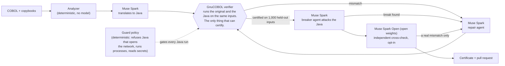

<p align="center"></p>

# Diocle

**AI writes the code. Diocle checks it against the original before anyone has to trust it.**

Diocle is a verification layer for AI-written code where a wrong cent costs money, starting with COBOL batch programs. Meta's Muse Spark converts COBOL to Java and repairs it. Nothing is accepted on the model's word: the original program runs next to the Java on the same inputs, and every output field, byte, exit code and display line must match, including on 1,000 held-out inputs the agent never saw. The result ships as a pull request with a certificate, and the target repository's CI repeats the test on fresh inputs.

## Why it matters

COBOL still runs about 43% of US banking systems and 95% of ATM swipes, with some 220 billion lines in use
(Reuters, 2017), and the people who wrote it are retiring. Rewriting it is where banks get hurt: TSB's 2018
core-banking migration locked close to two million customers out of their accounts, and its chief executive stepped
down. AI makes the rewrite fast; it does not make it safe. The risk is silent: Java that compiles, runs and is wrong
by a cent, or by the sign of zero on 30 inputs in a thousand. Diocle's job is to catch that before anyone ships it.

## Who benefits
Diocle is for the teams that inherit COBOL batch programs that move money and cannot afford a silent difference:
- **Credit unions, co-op banks and small banks** whose core batch jobs (interest, fees, postings, reconciliation) are decades-old COBOL, with no budget for a team of mainframe experts to re-check every cent.
- **Benefit, pension and insurance payment operators:** payments are computed by batch programs, and a wrong cent or a wrong sign repeated over millions of records lands on real people. The people who benefit from a verified migration are the ones those programs pay.
- **Modernization teams and auditors:** they get a certificate they can re-run themselves (the target repository's CI repeats the check on fresh inputs) instead of a model's opinion.

**What changes.** Today, equivalence is checked by hand or by sampling. Diocle runs the original and the Java on the same 1,000+ inputs per program, then lets a second agent attack the Java with inputs it designs, and refuses anything that differs. In our runs the model spend per certified program was about two cents at list prices (see the scoreboard on [/evidence](https://diocle.vercel.app/evidence)).

**Usable today** (no claim of adoption: this is what exists): the live site and its two live buttons; one command that certifies a sample with your own Meta key (about 12 seconds with no key, about 2.5 minutes with one; see [Quickstart](#quickstart-one-command)); a VS Code extension and a Notepad++ script (the extension is built and packaged; Marketplace publishing is pending); delivery of a whole repository as a pull request into a new private repository, with CI that re-verifies each program ([Let Diocle create the target repository](#let-diocle-create-the-target-repository-local-or-admin-only)).

**Honest limits.** Certified means "on the inputs tried", not proven for all inputs. Embedded SQL is verified on a SQLite stand-in for a named statement subset, never on real DB2. CICS and IMS are not supported.

## For judges: two minutes
- **Live product:** [diocle.vercel.app](https://diocle.vercel.app). The front page shows CHQCLR's COBOL next to its
  certified Java; press **Try the sample**, and both programs run again on about 1,000 inputs from a seed chosen
  right then. Or open [Delivery](https://diocle.vercel.app/delivery) and paste any public COBOL repository (small
  daily budget; every compile and run of imported code happens in a sandbox with no network and no credentials,
  while cloning, analysis and the model calls run in the engine).
- **Evidence, with links to every run:** [diocle.vercel.app/evidence](https://diocle.vercel.app/evidence),
  [docs/EVIDENCE.md](docs/EVIDENCE.md) (the canonical delivery, [quillmark-modern#4](https://github.com/Nivetha200111/quillmark-modern/pull/4),
  with its CI) and [docs/EVALUATION.md](docs/EVALUATION.md) (unseen programs, failures included).
- **Built during the hackathon (Oct 27 to Nov 4, 2026):** everything in this repository. The first commit is dated Oct 27, 2026 and nothing predates it: see the full [commit history](https://github.com/Nivetha200111/Diocle/commits/main) and [docs/BUILD_LOG.md](docs/BUILD_LOG.md). Not built here: GnuCOBOL (the original compiler we compare against), the Meta models, Remotion and Playwright (video tooling), the ElevenLabs synthetic narration (disclosed on the video's end card), and the public COBOL course repository we imported as test input (CC BY 4.0, credited on the Evidence page).
- **Meta models:** Muse Spark (Meta Model API) as translator, repair agent and breaker; **Muse Wonder** reads a photographed or printed COBOL listing back into COBOL that is then verified against the original, and can act as the breaker agent; **Muse Spark Open** (open weights, on Fireworks) is the independent cross-checker, the guard agent's model review (it can only revoke a certification, never grant one) and the private mode. Diagram and per-role detail: [Which model does what](#which-model-does-what). No other model is used in the product. The converter depends on the `openai` Python package only as an OpenAI-compatible HTTP client: its base URL is the Meta Model API (`https://api.meta.ai/v1`) or the Muse Spark Open host, set in `.env`; no OpenAI model is called.
- **Development tools:** the code was written with help from coding agents (Claude Code; see `.claude/` and the
  `Co-Authored-By` lines in the git log). They are development tooling only and are not part of the product.

## Which model does what



| Role | Model | Served by | What it may do |
|---|---|---|---|
| Translator, repair agent, breaker | Muse Spark (`muse-spark-1.3-contributor` by default) | Meta Model API | Write and patch Java, design attack inputs. Cannot certify. |
| Independent cross-check (`--crosscheck`, opt-in) | Muse Spark Open | Partner host (Baseten or Fireworks) | Propose inputs where it thinks the Java differs. Every input runs through GnuCOBOL and the Java; its opinion certifies nothing. |
| Guard review (optional, off on the live site) | Muse Spark Open | Baseten | One review of the final Java; can only revoke certification, never grant it. |
| Escalation tiers (`--tiers`, opt-in) | Muse Spark contributor, then `muse-spark-1.3`, then `muse-wonder-1.0` | Meta Model API | The repair agent moves up one tier after each failed certification round and the breaker attacks at tier 2 by default (Muse Wonder is opt-in with `MODEL_TIER_BREAKER=3`); hard caps on calls and dollars above tier 1. Not yet shown to repair better than tier 1 alone. |
| Private mode | Muse Spark Open replaces Muse Spark in all three agent roles | Partner host | Same loop on open weights, for code that must not leave your control. |
| **Verifier** | none, it is GnuCOBOL and a byte-for-byte comparison | Sandbox (no network, no credentials) | **The only thing that certifies.** |

The guard's deterministic policy runs on every run. Its model review is off on the live site (no key is configured
there), so the live site runs the policy only. The narration of the demo video is a synthetic voice from a non-Meta
service; Meta's speech model on the API (`muse-voice-transcribe-1.0`) transcribes speech and does not speak.

## What "certified" means, and does not

- **Means:** on every input tried (PIC boundaries, seeded random values, fixtures, corpus records, model-designed attacks and 1,000 held-out inputs), the Java's output records, display output and exit code equal those of the original COBOL compiled with GnuCOBOL 3.2 under IBM's TRUNC(STD) and DISPLAY defaults, or equal the mainframe's own captured output where golden files exist. CI repeats this with a seed Diocle never used.
- **Does not mean:** equivalence for every possible input (testing cannot show that), or equivalence to IBM Enterprise COBOL where GnuCOBOL differs from it and no mainframe output was captured. The demo golden files were produced by GnuCOBOL, so they exercise the replay path but are not mainframe evidence. CI reuses Diocle's verifier, so it shares its assumptions; it guards against tampering and lucky seeds, not against a flaw in the verifier itself.

## How this relates to other work

Vendors already generate Java from COBOL (for example IBM watsonx Code Assistant for Z, which also offers validation). Diocle's focus is narrower and open: a repair agent driven by executable evidence, certificates that pin every input to the result, delivery as an ordinary pull request, an independent CI re-run anyone can inspect, and the ability to audit conversions produced by any tool ("bring your own conversion").

- **Judging translations without running them.** IBM Research's evaluation of watsonx Code Assistant for Z's COBOL-to-Java output ([Froimovich et al., arXiv:2507.23356](https://arxiv.org/abs/2507.23356)) uses static checkers (variable-access, procedure-call and middleware-call matching, hallucination flags) and an LLM-as-a-judge on a 1-7 scale, and notes that proving two programs equivalent is undecidable. It does not report running the Java against the original COBOL. Diocle takes the other route: it runs both on the same inputs and compares every output byte, and a model only writes and repairs code, never judges it. Per-program proof matters because errors compound: if each of ten paragraphs is right 90% of the time, the whole program is right only about a third of the time (0.9¹⁰ ≈ 0.35), the paper's own illustration.
- **GnuCOBOL off the mainframe.** Bankdata and the University of Southern Denmark ([Askholm, Johnsen and Mauro, arXiv:2604.00936](https://arxiv.org/abs/2604.00936)) report a bank running GnuCOBOL in GitHub Actions for COBOL testing. The paper does not address where GnuCOBOL differs from IBM Enterprise COBOL; Diocle pins those differences (IBM TRUNC(STD) and DISPLAY defaults, EBCDIC collation) and replays captured mainframe output where it exists.
- **Parallel run.** The method is the "parallel run" migration pattern (Sam Newman, *Monolith to Microservices*): run old and new side by side and compare results. Diocle makes it automatic, per program, before the code ships, and again in the target repository's CI.

All code here was written during the Meta Global AI Developer Hackathon (building period Oct 27 to Nov 4 2026); nothing predates Oct 27. All COBOL and data are synthetic, for a fictional bank (Quillmark Trust & Savings).

## What runs today

```
GitHub repo link ─► analyze ─► Muse Spark translates ─► repair agent ◄─► verifier (GnuCOBOL vs Java)
                                                              │
                         breaker agent attacks ◄── held-out certification (1,000 unseen inputs)
                                                              │
                     pull request + certificate ─► target repo CI re-verifies on fresh inputs
```

| Part | What it does |
|---|---|
| `services/analyzer` | Deterministic, no model calls. Derives record layouts from copybooks (DISPLAY, COMP-3, COMP, COMP-5, COMP-1/2, all sign modes, P scaling, OCCURS, REDEFINES, edited PICs, COPY REPLACING), wires files through SELECT/FD/OPEN and JCL, resolves CALLed programs, and flags legacy behaviour: ROUNDED, truncation, silent overflow, code cut at column 72, clock reads, EBCDIC-sensitive comparisons, hex floats. Imports GitHub repositories: any public one for visitors (everything runs in an isolated sandbox), allowed owners for pull-request delivery. |
| `services/verifier` | The oracle. Compiles the COBOL with GnuCOBOL 3.2 (-std=ibm, plus IBM's TRUNC(STD) and DISPLAY defaults), runs both sides on boundary, random, fixture, corpus and model-designed inputs, and compares field by field and byte by byte, for one or several input and output files (match-merge, SORT USING/GIVING): text and fixed-length records, packed and binary data, RETURN-CODE, stdout, a pinned clock, EBCDIC collation. Golden-file replay judges the Java against captured mainframe output, with a layout-aware EBCDIC and IBM hex-float codec. `reverify` re-proves a delivery in CI. `sqlschema` turns the copybooks into SQL tables (`DECIMAL(p,s)` from the PIC, REDEFINES and OCCURS stated) and proves them by a round trip through SQLite that must return every record byte for byte; no model. |
| `services/converter` | Meta models only (Muse Spark hosted, or Muse Spark Open on Fireworks or Baseten). Translator, tool-using repair agent, breaker agent that designs inputs to break certified Java, guard agent, in progress (a policy that refuses to run Java that openly uses the network, processes, reflection, other environment variables or literal outside paths, a speed bump in front of the sandbox; and a Muse Spark Open review of certified Java that can revoke certification for leaks or test gaming), proof-gated fix memory, swarm mode (parallel agents share certified lessons mid-run), skill export. Hard caps on calls, rounds and attack cycles. |
| `services/api` | Serves runs and deliveries to the dashboard; `deliver` turns a legacy repo into a certified pull request on a target repo. |
| `services/mcp` | Diocle as an MCP server: `analyze_cobol`, `verify_conversion`, `certify_conversion`, `cobol_lessons`, so any agent's conversion can be checked. |
| `apps/web` | Dashboard: **Home** (COBOL next to certified Java, re-verify on a fresh seed), **Delivery**, **Live runs** (agent trace, Meta model per role, before/after, cost) and **Evidence** show real data. Other views, only in local builds, are a labelled mock. |
| `samples/` | Nine synthetic programs (the last three were added for DISPLAY-only, OPEN I-O and CALL identifier shapes: TXNLIST, LDGRWRT, FEEPOST) with naive Java ports: INTACCR, TXNPOST, FEESCHD, DAYCTRL (display records), PKDPOST (packed, fixed-length, with a golden set) and ACCTMTCH (match-merge, two inputs, two outputs). |

Sample estate repositories: [quillmark-mainframe](https://github.com/Nivetha200111/quillmark-mainframe) (a z/OS library export) → [quillmark-java](https://github.com/Nivetha200111/quillmark-java) (certified Java, re-verifying CI); and [quillmark-legacy](https://github.com/Nivetha200111/quillmark-legacy) (COBOL in) and [quillmark-modern](https://github.com/Nivetha200111/quillmark-modern) (certified Java out, with re-verifying CI).

### Try it live (two public buttons, no input accepted)

On the Mission control page (`/mission#live`, linked from the home page) a visitor can press one of two buttons and watch a real Meta model call run and be verified:

- **Convert a sample now** converts the bundled synthetic program `samples/addfee` with Muse Spark through the normal pipeline (translate, differential test against GnuCOBOL in the sandbox, held-out certification). The result is an ordinary run record, labelled a live sample run (run schema v0.16 `sampleRun`) with its model card, cost and Re-verify. Live sample runs are listed but left out of the scoreboard statistics and the certified counts, so a button anyone can press cannot move the numbers. Measured: about $0.002 to $0.003 and 1 to 2 minutes.
- **Read a printout** sends the bundled picture of a COBOL listing (`samples/loyalty-waiver-printout/listing.png`) to Muse Wonder, then compiles the COBOL it wrote and runs it against the original `samples/loyalty-waiver` on about a thousand inputs, inside the sandbox container only (`transcribe --sandbox`, sandbox `POST /transcript`; model-written COBOL is never built or run beside the API's secrets). It shows the image, the transcribed COBOL and the verdict with the real case count. A model reading a printout certifies nothing; the comparison decides, and a mismatch is shown as a mismatch. Measured: about $0.06 and 30 seconds.

Why no input is accepted: the only request field is `sample`, one of two fixed names (anything else, including extra fields, is rejected with 422). Nothing a visitor sends reaches a model prompt, a command line, a path or the sandbox, so there is no upload surface to attack and the cost of a press is known in advance.

Caps (rule 10; `services/api/diocle_api/livesamples.py`): per run `--max-usd 0.02` (convert) and `VISION_MAX_USD 0.10` (printout); per visitor per day 3 and 1; per day overall 20 and 5; one live job at a time, shared with visitor imports and deliveries, and a minimum gap between two live starts across all visitors (`DIOCLE_LIVE_COOLDOWN_SECONDS`, default 90, so one actor cannot hold the shared lock back to back; the per-visitor counts are best effort because the visitor key is a client-supplied header, the per-day counts and the budget are the hard limits); both buttons together at most `DIOCLE_PUBLIC_SAMPLES_BUDGET` (default 1.0) dollars in 24 hours, drawn from the public daily budget (`DIOCLE_PUBLIC_DAILY_USD`, so imports keep the rest). When a cap or the budget is used up the button is disabled and says exactly why (`GET /config` -> `publicImports.samples`). `DIOCLE_PUBLIC_SAMPLES=0` switches both off; unset, they follow `DIOCLE_PUBLIC_IMPORTS=1`, and they always need the sandbox. The printout button also needs `VISION_MODEL_ID` in the engine's environment (without it the intake reports that it is off and the press is spent). Contract: `contracts/live-sample.schema.json`.

### EXEC SQL (embedded SQL), verified on a stand-in database

A stated subset of DB2-style embedded SQL (`db2-subset-1`: INCLUDE SQLCA, DECLARE TABLE or DCLGEN or a `*.sql` DDL file as the schema, host variables with null indicators, SELECT INTO, INSERT, UPDATE, DELETE, simple cursors, COMMIT, ROLLBACK, SQLCODE 0 / +100 / a small set of errors) is converted and verified: the COBOL (rewritten by Diocle's own small precompiler into calls to a C shim) and the Java (JDBC) run on the same seeded database plus the same generated input files, and their files, stdout, exit code **and the final contents of every table they touched** are compared value for value. **This is a stand-in engine (SQLite), not DB2.** What a certificate says is "equivalent on this engine, for these statements, on the inputs tried", never "DB2-verified": DB2 types, isolation, error codes beyond the small set, EBCDIC collation and DB2-only SQL are not modelled. Everything outside the subset (dynamic SQL, stored procedures, joins, DB2 functions and special registers, FETCH FIRST, WITH UR, FOR UPDATE, multi-row operations, LOBs, DATE/TIMESTAMP) is refused with the exact line and reason; CICS and IMS are out of scope. Details, the exact subset, known gaps and the security model: [`services/verifier/README.md`](services/verifier/README.md). Sample: [`samples/db2-account-report`](samples/db2-account-report) (refused on purpose: [`samples/db2-dynamic-sql`](samples/db2-dynamic-sql)). Needs the engine image rebuilt (`libsqlite3-dev`, SQLite JDBC driver); not yet exercised in the real sandbox container.

### Keyed (INDEXED / VSAM KSDS-style) files, verified on GnuCOBOL's indexed-file handler

Coverage in one line: **QSAM yes, DB2 subset yes, VSAM keyed files: a subset, on GnuCOBOL's handler.** The claim is narrow and exact: *the Java and the original COBOL leave the same keyed-file contents and print the same output, for this subset of file operations, on the inputs tried, where the original runs on GnuCOBOL's INDEXED handler (Berkeley DB).* It is not IBM VSAM: no CI/CA splits, no alternate indexes, no record locking, no IDCAMS.

- **Subset `ksds-subset-1`:** `ORGANIZATION IS INDEXED`, one `RECORD KEY` (an elementary alphanumeric or unsigned DISPLAY numeric field of the record), `ACCESS MODE` SEQUENTIAL, RANDOM or DYNAMIC, a `FILE STATUS` item (required), `OPEN INPUT | OUTPUT | I-O` (one mode per file), `READ`, `READ NEXT`, `WRITE`, `REWRITE`, `DELETE`, `START KEY =, >=, >` (and `NOT <`), `CLOSE`, with the `INVALID KEY` / `AT END` phrases. FILE STATUS codes 00, 10, 21, 22, 23, 35, 41, 42, 43, 46, 47, 48, 49 are modelled.
- **How it is proven:** the verifier seeds identical keyed files for both sides (unique keys incl. boundary keys, keys that sort differently in ASCII and EBCDIC, gaps, and keys the generated transaction file will hit and miss), runs the Java first (own directory, own copy) and then the original (its own file), and compares the final contents record by record in key order, plus the output files, stdout and exit code (`runs.keyed`, one `keyed:DD` result per file, verification-report v0.10). The Java reaches keyed files only through `DioKsds`, the verifier's own support class; it reproduces the handler's observable behaviour and is itself tested against the real handler with randomised operation sequences. A finding worth knowing: GnuCOBOL's indexed handler orders keys by raw bytes even under the `-fdefault-colseq=EBCDIC` the verifier uses for mainframe programs, so `START` and `READ NEXT` follow byte order; the Java is told so.
- **Run it locally:** needs a GnuCOBOL built with an indexed handler (`cobc --info` shows `indexed file handler : BDB`; Homebrew's does) and a JDK. `python -m diocle_verifier samples/vsam-customer-update`, or `python -m diocle_converter run samples/vsam-customer-update --max-usd 0.15`. The engine image builds GnuCOBOL `--with-db` (see `deploy/Dockerfile.api`).
- **FILE STATUS is observed only through its effects.** The program's FILE STATUS codes (23 not found, 22 duplicate key, 21, 10, ...) are not read out and compared directly; they are compared through what they cause: rejected records, output files, DISPLAY output, exit code and the final keyed-file contents.
- **Refused with the exact reason:** alternate keys (`samples/vsam-alternate-key`), WITH DUPLICATES, RELATIVE files, LOCK MODE and READ WITH LOCK, READ PREVIOUS, START with `<` or `<=`, OPEN EXTEND, a file opened more than one way, group, signed, packed or binary keys, no FILE STATUS, DECLARATIVES, keyed files together with EXEC SQL.

### Verified documentation

`python -m diocle_converter run SAMPLE --document` (or `document SAMPLE` on its own) has a Muse Spark model write a plain-English behaviour spec of a COBOL program as claims, each with concrete examples (input records and expected output fields). The original COBOL, compiled with GnuCOBOL and run in the sandbox, then decides every claim: **confirmed on the examples tried** (the examples' stated expectations held on GnuCOBOL; the claim's sentence itself is not machine-checked, and numbers are compared by value, not byte for byte), **refuted** (the actual value is kept and shown) or **unchecked** (invalid example, the program did not run or ended with a return code the example does not expect, or the expectation compares nothing but a record count or return code). The model never decides, and "confirmed" is not "proven". Wrong claims are caught and shown, not hidden. The dashboard shows it as the Behaviour spec panel with a Markdown download. Contract: `contracts/behavior-claims.schema.json`. Single-file record programs only; opt-in, capped (2 calls, $0.10) and never fails a run. Not deployed to the live engine yet.

## Measured so far (pilot evidence: synthetic programs, small samples; costs are estimates from list prices)

- **Canonical delivery: [quillmark-modern#4](https://github.com/Nivetha200111/quillmark-modern/pull/4).** Six Quillmark programs (including a packed fixed-length extract and a two-input, two-output match-merge), translated from scratch by Muse Spark, all certified under one pinned byte-exact verifier, then re-verified by the target repository's GitHub CI on **6,719 fresh inputs with 0 differences** ([CI run](https://github.com/Nivetha200111/quillmark-modern/actions/runs/40811476870)). About $0.13 of model spend for the six conversions.
- **Correction (Oct 28).** An independent review showed the comparator paired output records with inputs and compared numeric fields by value, so `+00` and `-00` counted as equal. It now compares the whole output sequence byte for byte. Re-checking every certified run found one that should not have passed: the INTACCR in the earlier quillmark-modern#3 writes `-000000000` where the COBOL writes `+000000000` on 30 of 1,019 inputs. INTACCR was converted again (the repair agent fixed the negative-zero case itself) and the other five programs were re-certified under the new verifier at zero model calls; that is #4.
- **Unseen programs:** the frozen evaluation certified 2 of 4; both failures were the old comparator rejecting aggregation and fan-out. Re-run with the corrected verifier and fix memory off: **4 of 4 certified for about $0.11**, each passing five fresh seeds ([docs/EVALUATION.md](docs/EVALUATION.md)).
- **Copybooks as SQL:** for all 11 sample and evaluation programs (24 tables), generated records (PIC boundaries and seeded random values) fit the published column types and come back from SQLite byte for byte; so do PKDPOST's golden files after EBCDIC conversion. The front page and Live runs show each run's `schema.sql` next to its Java.
- **Breaker agent:** on CHQCLR it broke Java that had passed 1,004 held-out inputs (fee 20.00 vs 0.00); the repair agent fixed it and it re-certified on 1,006 fresh ones.
- Fix memory over 18 runs: 30% lower cost and 37% less model time on average than without memory.
- Costs are estimates from list prices.

## Coverage today: what Diocle verifies, and what it does not
By kind of mainframe artifact, as of Oct 30, 2026 (also on the [Evidence page](https://diocle.vercel.app/evidence)). "In progress" means not merged or deployed yet; certified always means on the inputs tried.

| Artifact | Status | What is checked | Limit |
|---|---|---|---|
| Sequential files (QSAM-style) | Verified | Outputs compared byte for byte, original on GnuCOBOL against the Java, plus 1,000 held-out inputs | On the inputs tried |
| Copybooks (COPY, REPLACING) | Verified | Layouts come from the copybooks; verification and SQL schemas derive from them | Copybooks outside the repository refuse the program with a reason |
| Static CALLs between programs | Verified | Called programs are translated together and linked into one executable | Dynamic CALLs and calls to programs not in the repository are refused |
| JCL jobs | Partial | One SORT step feeding one COBOL step, with DD overrides: every final dataset compared | Runs through the converter's `run-job` command, not the web delivery flow; longer jobs, several SORT steps, COND-gated steps and IDCAMS are refused with a reason |
| Embedded SQL (DB2) | Subset | A named subset (SELECT INTO, INSERT, UPDATE, DELETE, cursors, COMMIT, ROLLBACK, SQLCODE), final table contents compared | On a SQLite stand-in, never real DB2; dynamic SQL, joins and DB2-only clauses are refused |
| Keyed files (VSAM KSDS-style) | In progress | A keyed-file subset compared by key order on GnuCOBOL's indexed-file handler | Refused today |
| Whole-repository build check | Partial | Compiles every converted program together, flags copybook drift and CALL signature mismatches, and puts a build report in the pull request | Built and merged, not deployed to the live engine yet, CI step not yet run on GitHub; JCL step order not checked; customer domain classes are an experimental compile-time check only |
| Hierarchical database (IMS DL/I) | Not supported | There is no free IMS runtime to compare against | Roadmap |
| CICS online transactions | Not supported | Programs with EXEC CICS are refused with a reason | |

## Not supported yet
- The whole-repository build check is a compile and interface check of the certified programs: it does not run them together, does not follow JCL step order or dataset wiring, and compares CALL argument lengths only for plain 01/77 items. Domain classes (`--domain-classes`) are compile-time only and experimental.
- The live buttons convert one fixed program and read one fixed printout; there is no way to try your own code on the public site (use a visitor import, or run it locally). On the Convert button the guard model's review (Fireworks) is skipped by the $0.02 cap and says so in the run (`review failed: BudgetExceeded`); the verifier's result is unaffected.
- **Convert anyway (local or admin only, see "Running on your own repo") never certifies what the verifier could not run.** Programs the analyzer refuses (EXEC SQL outside the verified subset, CICS/DLI, keyed files outside the subset, dynamic or external CALLs, missing copybooks, no output) are translated with labelled `// ADAPTER REQUIRED` interfaces (no invented database behaviour), compile-checked with `javac`, never executed, and labelled `COMPILED, NOT VERIFIED`; nothing here is a working DB2, CICS or keyed-file conversion. An original that does not compile under GnuCOBOL gets a bounded patch first (see the rule below) and its Java is labelled `VERIFIED AGAINST REPAIRED COBOL`, which is not `CERTIFIED`. Visitor imports on the public site cannot enable the mode and keep refusing as before.
- Programs with EXEC SQL outside the verified subset (dynamic SQL, stored procedures, joins, DB2 functions and special registers, FETCH FIRST, WITH UR, FOR UPDATE, WHERE CURRENT OF, multi-row operations, LOB/DATE/TIMESTAMP columns, no schema source; the subset that is verified runs on a SQLite stand-in, not DB2), CICS or DLI (out of scope), RELATIVE files and INDEXED files outside `ksds-subset-1` (alternate keys, duplicates, locking, EXTEND, group/signed/packed keys, no FILE STATUS; real IBM VSAM, IDCAMS and alternate indexes are never covered, and the keyed subset has not been run in the production sandbox yet), LINE SEQUENTIAL files opened I-O (only fixed-record SEQUENTIAL files are updated in place), a file opened I-O in one place and another way elsewhere, CALL identifiers that anything other than literals can assign (STRING, UNSTRING, ACCEPT, READ INTO, a LINKAGE parameter, a MOVE from a field, a second literal), DISPLAY-only programs that ACCEPT from the console or that DISPLAY only UPON SYSERR, programs with no output file and no DISPLAY, a JCL job whose COBOL step is DISPLAY-only or updates a file in place (the job check compares output files only), several record types in one file, OCCURS DEPENDING ON, SYNCHRONIZED, PIC N or leading P scaling are reported as not convertible. Each new shape we found unhandled was added to this list with a test; there may be others.
- A program whose original COBOL does not compile under GnuCOBOL `-std=ibm` (for example a missing period after `PROGRAM-ID`, which IBM's compiler accepts) cannot be verified. Visitor imports find this before any model call with a compile-only check in the sandbox, skip the program with the compiler's reason and give its slot to the next compilable program (at most 12 programs checked per import; if the sandbox is unavailable the check is skipped). Other paths (CLI runs, owner deliveries) still find it only after the first translator call, where the run stops with that reason. Diocle does not repair or rewrite the original so that it compiles.
- DISPLAY-only and OPEN I-O programs are accepted from what the source says, not from a run: a program whose DISPLAY (or REWRITE) never fires on the generated inputs, or that prints something nondeterministic such as `FUNCTION RANDOM`, cannot certify, and this is found only at verification time, after the translator call has been paid for. Neither shape has been through a real model conversion yet; the three synthetic samples (`display-report`, `ledger-rewrite`, `call-identifier`) are proven with hand-written Java only.
- JCL jobs convert end to end only in one shape: one SORT step (SORT FIELDS= with character keys, optional OPTION EQUALS) feeding one COBOL step. Jobs with three or more steps, several SORT steps, COND-gated steps, numeric (ZD/PD/BI) sort keys, INCLUDE/OMIT, INREC/OUTREC, SUM or MERGE are reported as not convertible with a reason. The job-level check is a library function (`diocle_verifier.jobs.verify_job`), not yet wired into the CLI or the delivery flow.
- SQL schemas are proven on SQLite only. Alphanumeric fields that carry binary bytes (LOW-VALUES, a REDEFINES over packed data) would need BYTEA/BINARY in PostgreSQL or DB2, and a record type split behind a REDEFINES is kept as the shared bytes, not as typed columns per variant.
- Without golden files, the oracle is GnuCOBOL, which can differ from IBM Enterprise COBOL in edge cases (intermediate precision, NUMPROC, hex float arithmetic). No real mainframe output has been tested yet.
- The breaker agent attacks single-file programs only. In the frozen evaluation it broke CHQCLR after the program had passed 1,000 held-out inputs: two designed records gave a fee of 20.00 vs 0.00 and a debit of -121.23 vs 0.00; the repair agent fixed both and the program re-certified. Both records carry malformed numeric content (a leading space, letters in a numeric field), so this shows agreement with GnuCOBOL's handling of bad data, not proven IBM behaviour.
- Verified documentation covers single-file record programs only (multi-file, DISPLAY-only and I-O programs are skipped), checks only the examples a model wrote, and is not on the live engine yet.
- The VS Code extension (`editors/vscode`) runs the local converter only (no engine mode, no Marketplace listing), needs a Diocle checkout for the converter, GnuCOBOL and a JDK, and converts one file at a time. It was exercised in a real VS Code extension host for `check` and `convert`; Cursor, VSCodium and Windsurf were not run.


## Run

### Quickstart (one command)

```sh
sh scripts/quickstart.sh --no-key     # no key, no model: re-verify a checked-in certified conversion, seconds
cp .env.example .env                  # then set META_MODEL_API_KEY= (your own Meta key); never pass it as an argument
sh scripts/quickstart.sh              # one real, capped conversion of a small sample (default cap $0.10)
```

It checks GnuCOBOL 3.2+, JDK 21+ and Python 3.11+ (with an install hint per OS), builds one venv, and prints the
CERTIFIED line, the inputs behind it, model, tokens, estimated cost and where the Java and run record were written.
Without a key it falls through to the no-key mode and says that no model was called. `QUICKSTART_MAX_USD` raises the
cap (hard maximum $1.00); `--sample NAME` picks another sample (no-key mode needs a `certified-java/` folder, only
`interest-accrual` has one). Measured on a Mac from a clean clone: no-key mode 12 s including the one-time venv (2 s to verify), key mode about 2.5
minutes (model time dominates) and about $0.003 for one INTACCR conversion; times vary with the model host. Linux is
untested. No Docker image is provided for the quickstart.

Needs GnuCOBOL 3.2 (`cobc`), JDK 21 and Python 3.11+. Each service has its own README with setup and test commands. Model keys go in `.env` (see `.env.example`); nothing secret is committed.

### Using your own Meta key

Judges do not need a key: the live site, **Try the sample** and the public re-verify run on our engine. To run the
converter yourself:

1. Create an API key for the Meta Model API in your Meta developer account at [dev.meta.ai](https://dev.meta.ai).
2. `cp .env.example .env`, then set `META_MODEL_API_KEY=` (the base URL `https://api.meta.ai/v1` and the model
   `muse-spark-1.3-contributor` are already filled in; use `muse-spark-1.3` for anything private).
3. Optional, for private mode or the independent cross-check: set `OPEN_MODEL_API_KEY`, `OPEN_MODEL_BASE_URL` and
   `OPEN_MODEL_ID` (Fireworks and Baseten examples are in `.env.example`).
4. Check the key and endpoint: `cd services/converter && .venv/bin/python -m diocle_converter smoke` (one tiny call,
   about a hundredth of a cent). A first full run on a sample costs a few cents; every model loop has hard call caps
   (`MODEL_MAX_CALLS_PER_RUN` and the others in `.env.example`).

### Whole-repository build check

Migration teams spend nights compiling every converted program together. Diocle certifies each program on its own; the build check
(`diocle_verifier.buildcheck`, contract `contracts/build-report.schema.json`) looks at the delivered programs **together**.

**What it checks**
- All converted Java compiled in **one** `javac -proc:none` run (no network, nothing executed), and each program alone. Top-level class names declared in more than one program (identical copies too, because the generated CI compiles every file and javac reports those as duplicate classes there as well).
- **Copybook drift**: the same copybook member with different text across files (warn) or different record layouts for the same `COPY` (fail).
- **CALL resolution**: every static `CALL 'X'` must name a program of the repository; the callee's `PROCEDURE DIVISION USING` count must be satisfied and argument byte lengths compared where both sides are plain 01/77 items (callee longer than the caller's item = fail, shorter = warn), with exact file and line.
- A dependency graph of programs, copybooks, calls and files, and a verdict `pass | fail | warn` with one reason per cause.

**Known limits**: a `module-info.java` inside a program folder makes the whole compile fail (the gate compiles every file as one classpath unit; it says so rather than hiding it), and two classes whose names differ only by case are not detected on case-insensitive file systems. The compile uses an `@argfile`, so thousands of files and spaces in paths are fine.

**What it does not check**: how the programs behave together (each is still verified alone by differential testing), JCL step order and dataset wiring, subscripted or computed CALL arguments, dynamic CALLs, programs outside the repository. `scope.notChecked` in the report always says so.

**How the generated Java is built** (found by looking at real certified runs): the translator writes one self-contained file per program, default package, one public class named after the program; copybook records are inlined as private fields or nested holders, never shared POJOs; CALLed modules are translated into the caller's file. So a duplicate class name or a missing symbol can only come from two programs of the same name or from a hand edit, and the real work of the gate is the COBOL-side interface checks plus the single compile. Programs with embedded SQL need the verifier's own `DioSql.java`, which is not part of the delivered programs: the gate adds it for its compile and reports it as a warning.

```sh
cd services/verifier
.venv/bin/python -m diocle_verifier.buildcheck --program HRFEE020 JAVA_DIR SAMPLE_DIR --program HRINT010 JAVA_DIR SAMPLE_DIR \
    --report analysis-report.json --out build-out     # writes build-report.json and BUILD-REPORT.md; exit 1 on fail
```

**In a delivery** it runs after certification. The pull request gets `build/BUILD-REPORT.md` and `build/build-report.json`, the body has a
"Whole-repository build check" section, and the Delivery page a "Build check" card. A failing build does **not** block the delivery of programs that
are certified on their own; the body says in bold that the whole-repository build did not pass and why. The generated CI also compiles everything
together (`javac -proc:none -d "$RUNNER_TEMP/out" $(find programs -name '*.java')`, adding `DioSql.java` from the pinned Diocle commit when programs use it) and fails the job on error. No `pom.xml` is generated (the programs sit in separate `programs/*/java` folders in the default package).

**EXPERIMENTAL: bring your own domain classes.** `--domain-classes PATH` (a directory of `.java` files, or one `.jar`; local only, `deliver` and `buildcheck`)
puts your own classes on the javac classpath, so the converted programs are checked to compile beside your codebase, and a program class with the
same name as one of yours is reported. The classes are only read by javac (and `javap -public` for a jar); they are never loaded or run, never
extracted (javac and `javap` read a staged copy; a relative `Class-Path` entry in the jar's manifest cannot reach beside the original, but absolute or `file:` entries are not confined and javac may read those paths as class bytes), and the verifier's runs never see them. With `diocle_converter run --domain-classes PATH`, when a class name matches a COBOL record or copybook
name (case, hyphens and a trailing REC/RECORD ignored), the translator is shown that class's **public signature only** (no bodies) and is told to shape
its nested record holder after it (same field and accessor names) but **not** to reference it, because each program is still compiled and verified alone.
So the converted programs do not yet use your classes; a swap-in is a reviewer's step and is not verified. One real run (ADDFEE, a tiny synthetic class) did shape its holder after the class and certified 1,005 of 1,005.

### Let Diocle create the target repository (local or admin only)

Instead of supplying an existing target, a delivery can create its own repository and open the pull request into it:

```sh
cd services/api
.venv/bin/python -m diocle_api.deliver https://github.com/<owner>/<legacy> --create-target <legacy>-java --dry-run   # prints the plan, creates nothing
.venv/bin/python -m diocle_api.deliver https://github.com/<owner>/<legacy> --create-target <legacy>-java            # creates it, then the usual delivery
#   --target-owner OWNER   default: the account `gh` is logged in as; --target-public: public (default is private)
```

It uses your own `gh` login (or `GH_TOKEN`, read by `gh`, never printed); the token needs the `repo` scope, plus `workflow` because
the first pull request adds `.github/workflows/reverify.yml` (a repository Diocle creates has no CI of its own). The owner must be on
the same allowlist as any target (`DIOCLE_IMPORT_OWNERS`). The repository is created only after at least one program is certified. It is
private unless you pass `--target-public`. It never reuses, overwrites or pushes into an existing repository (it refuses and tells you to pass
the URL as the target), and never makes anything public implicitly. If a step fails after creation the repository stays, and the message
gives the `gh repo delete OWNER/NAME --yes` command for you to run if you want it gone. The dashboard offers it as "Create a new
repository for the result" (admin passcode, or local); visitors never see it and the API refuses it (403) without the passcode. A delivery
without any target still keeps its results on the site.

### Running on your own repo (local, your own key)

Any COBOL repository, local directory or GitHub URL, with your own Meta key and no visitor caps:

```sh
# prerequisites: GnuCOBOL 3.2 (cobc), JDK 21, Python 3.11+, the services' venvs (see each README), META_MODEL_* in .env
cd services/converter
.venv/bin/python -m diocle_converter repo /path/to/legacy-repo --convert-anyway        # or https://github.com/<owner>/<repo>
#   --repo-max-usd 2.50   raise REPO_MAX_USD for this run (default 1.00, enforced across every program of the run)
#   --programs PAYROLL,LEDGER   only these PROGRAM-IDs
# equivalent: cd services/api && .venv/bin/python -m diocle_api.deliver /path/to/legacy-repo --convert-anyway
# one program: python -m diocle_converter run SAMPLE_DIR --convert-anyway --max-usd 0.20
```

Without `--convert-anyway` (and without `DIOCLE_CONVERT_ANYWAY=1`) nothing changes: refused programs stay refused. The
results stay under `runs/` and show on the dashboard; pass a target repository to `diocle_api.deliver` to open a pull request
(it lists every program under its label). Every program ends with exactly one label:

| Label | Meaning | Counted as certified? |
|---|---|---|
| `CERTIFIED` | The differential test passed against the original COBOL, as always. | yes |
| `VERIFIED AGAINST REPAIRED COBOL` | The original did not compile under GnuCOBOL `-std=ibm`; the COBOL was patched (diff in the run record, the patched file is written beside your file as `<name>.repaired.cbl`, your file is never touched) and the Java passed against the patched COBOL. A person must confirm the patch preserves what the IBM compiler accepted. | no |
| `COMPILED, NOT VERIFIED` | The Java compiles with `javac`; no differential test could run (the reason is stated); the Java was never executed. A developer must review it. | no |
| `FAILED` | No compiling Java within the caps, or the differential test ran and the Java still differs. | no |

A program that compiles and verifies normally is certified normally even in this mode. Programs skipped when `REPO_MAX_USD`
is reached are recorded as `skipped: repo spend cap reached`, never dropped. Model use stays within the per-run call caps and a
dollar cap (`--max-usd`, the rest of `REPO_MAX_USD`) and logs tokens and cost per program.

**The COBOL patch rule** (enforced in `diocle_converter/cobolrepair.py`, not just asked of the model): first mechanical fixes that
cannot change behaviour (today: the missing period after `PROGRAM-ID`); only if the original still does not compile, a bounded
Muse loop with `compile_cobol` and `patch_cobol` tools (at most `COBOL_REPAIR_MAX_CALLS`, default 8, inside the run caps; tier
escalation with `--tiers`). The patched file may differ from the original by at most `COBOL_REPAIR_MAX_LINES` (20) and
`COBOL_REPAIR_MAX_SHARE` (10%) of its lines, whichever is smaller, and a patch may only change a line the compiler reported in a fresh compile (fixed-format files only, no lines added, removed or
blanked; per line one identifier correction of at most 3 characters, a missing period, or one added TO/THEN/IS/DIVISION/SECTION).
Not enforceable: that a corrected identifier is the one the author meant, that an added period does not end an IF or EVALUATE early,
or that an inserted word is in the right place (the compiler rejects a misplaced one); a person must confirm the patch. A rejected patch is not applied; the compiler, not the model, decides whether it
now compiles. Programs the analyzer refuses (EXEC SQL, keyed files, ...) are not COBOL-patched; programs that compile but never
finish, or fail for reasons other than compile errors, are not patched either.

What is still never certified, and why: anything the verifier could not run against GnuCOBOL (database and transaction calls,
keyed files, calls to programs outside the repository, unknown copybook layouts, repaired or uncompilable originals). Only the
verifier certifies; the model's Java is compiled, never trusted. This mode is not reachable from the public site: a visitor
request that sets it is refused (403), and the visitor job strips `DIOCLE_CONVERT_ANYWAY` from its environment. **A hosted engine must set `DIOCLE_HOSTED=1` and a long random `DIOCLE_ADMIN_TOKEN`** (see `deploy/diocle.env.example`): with both unset the admin check is open, and the API then only accepts `convertAnyway` from the machine itself (loopback, no proxy headers). `python -m diocle_converter run --convert-anyway` without `--max-usd` is capped at `REPO_MAX_USD` or $0.25.

See [CLAUDE.md](CLAUDE.md) for contributor rules and [docs/ARCHITECTURE.md](docs/ARCHITECTURE.md) for the design.

## Editors

- **VS Code and forks** (Cursor, VSCodium, Windsurf): `editors/vscode` checks that a COBOL file compiles under GnuCOBOL (errors in the Problems panel) and converts and verifies it from the editor with your own Meta key on your machine, capped in dollars; results carry the same honest labels as the dashboard. See `editors/vscode/README.md`. Add `.diocle/` to your `.gitignore` (results are written there). Not published to a marketplace yet.
- **Notepad++** (Windows): `editors/notepadpp`, a PythonScript plugin script (or NppExec scripts) around the same CLI: check with annotations on the reported lines, convert with a cost prompt and the same honest labels. Built on macOS: the logic and the CLI path are tested, **the Notepad++ API calls are untested**. See `editors/notepadpp/README.md`.

## License

MIT. See [LICENSE](LICENSE).

Licence note: the engine image builds GnuCOBOL `--with-db` against Berkeley DB (Sleepycat/BDB, `libdb-dev`, `libdb5.3t64`) for INDEXED files. GnuCOBOL's runtime is LGPL, and BDB 5.x is under the Sleepycat licence (copyleft for distributed combined works); Diocle runs it server-side and does not redistribute the image.
