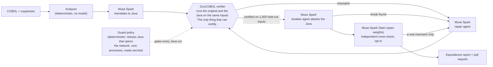

Demo video (3 min): LINK_TO_BE_ADDED_BEFORE_SUBMISSION

<p align="center"></p>

# Diocle

[](https://github.com/Nivetha200111/Diocle/actions/workflows/test.yml)

**AI writes the code. Diocle checks it against the original before anyone has to trust it.**

Diocle is a verification layer for AI-written code where a wrong cent costs money, starting with COBOL batch programs. Meta's Muse Spark translates COBOL to Java and repairs it; the original, compiled with GnuCOBOL, runs next to the Java on the same inputs, and every output byte, exit code and display line must match, including on 1,000 held-out inputs the agent never saw. A model never certifies; the comparison does. Built for the Meta Global AI Developer Hackathon (Indie track). All programs and data are synthetic.

## Why I built this

I have worked on a COBOL modernization project at a global finance company. Reviewing the translated code by hand took so much effort that it drained the project's timeline. AI can now write the Java quickly, but someone still has to decide whether it is right, and a wrong cent repeats on every account (TSB's 2018 migration is the public example, see below). I built the check I wished that project had: run the original and the Java on the same inputs and compare every byte. No code or data from that work is in this repository; every program here is synthetic and written during the hackathon.

## The measured finding (15 synthetic programs, one model; [docs/MEASUREMENT.md](docs/MEASUREMENT.md))

- **4 of 10 attackable translations that passed 1,000 held-out inputs were still wrong when attacked** (CHQCLR, DAYCTRL, INTACCR, TXNPOST; n = 10 programs, one fresh translation each, the breaker agent's inputs checked against GnuCOBOL). Passing the test is not the same as being right.
- Context, with its denominators: Muse Spark's first translation passed 1,000 held-out inputs in **37 of 45 attempts** (82%; counts attempts, 3 per program x 15 programs), and **all 15 programs passed at least once in three tries** (counts programs). Full Diocle runs certified **14 of 15 programs** (counts programs, one run each). These count different things: read them as context, not as "model alone vs Diocle".
- **CHQCLR was not certified in the controlled run** (fix memory off, policy-only guard, default caps), yet it shows as certified on the live site because of an earlier run with fix memory on: [CHQCLR: certified or not?](#chqclr-certified-or-not)
- About **$0.69** of raw model spend for the whole measurement at list prices (excludes compute, hosting and human review; no comparison with human cost is made).
- Small sample, one model, synthetic programs; the per-program table, caveats and deviations are in the measurement document.

## Judge path: three clicks

1. Open [diocle.vercel.app](https://diocle.vercel.app): CHQCLR's COBOL next to its certified Java. Press **Try the sample**: both programs run again on about 1,000 inputs from a seed chosen right then (free, no model call).
2. Open the [CHQCLR run trace](https://diocle.vercel.app/#run=chqclr-20261028-214355): the Java passed 1,004 held-out inputs, then the breaker found 2 of 24 designed inputs that broke it (fee 20.00 vs 0.00), the repair agent fixed it, and it re-certified on 1,006 fresh inputs.
3. Open [Evidence](https://diocle.vercel.app/evidence) for every run and the cost scoreboard, then [docs/CLAIMS_TO_EVIDENCE.md](docs/CLAIMS_TO_EVIDENCE.md) to check each headline claim in under a minute. Optional: the two live buttons on [Mission control](https://diocle.vercel.app/mission#live) (capped, no input accepted).

As of Oct 31, 2026 the public run list has 36 runs, 29 certified (26 excluding 3 labelled live sample runs); median model spend per certified run about 2 cents ($0.0179), mean about 6 cents ($0.0587).

## Run it yourself in 5 minutes

Needs GnuCOBOL 3.2 (`cobc`), JDK 21 and Python 3.11+. The quickstart script itself is only tested on macOS; the test suites also run on Linux in CI.

```sh
git clone https://github.com/Nivetha200111/Diocle && cd Diocle
sh scripts/quickstart.sh --check      # checks prerequisites, with an install hint per OS
sh scripts/quickstart.sh --no-key     # no key, no model call: re-verifies a checked-in certified conversion
```

Measured on a Mac from a clean checkout on Oct 30: about 23 s, 1,027 of 1,027 inputs (most of that is the one-time environment setup). With your own Meta key, see [Quickstart](#quickstart-one-command) (about 2.5 minutes, a few cents). `make test` runs all four suites; CI runs them on every push.

## Where Meta models are used

| Model | Role | Evidence strength |
|---|---|---|
| Muse Spark (`muse-spark-1.3-contributor`) | Translator, repair agent, breaker | 34 of 36 public runs; the measurement above |
| Muse Spark Open (open weights, partner inference on Fireworks) | Private mode, cross-check, guard review | n=1 public run (INTACCR certified); not in the headline measurement |
| Muse Wonder | Read a printout; opt-in breaker tier | n=1 per use |
| Muse Voice Transcribe | Spoken question about a program | One live public ask |
| Muse Code | Local plugin for the agent | Five recorded runs, prompts named the tools |

Not used: Muse Image, SAM 3.1, Muse Glimmer. File paths, run ids and the full table: [docs/META_MODELS.md](docs/META_MODELS.md). No non-Meta model is called by the product.

## Built here vs pre-existing

First commit Oct 27, 2026 (14:46 IST); nothing predates the building period (Oct 27 to Nov 4, 2026). Built here: the analyzer, converter agents, verifier, delivery, API, dashboard, sandbox, extensions and the measurement harness. Pre-existing and used: GnuCOBOL 3.2, Berkeley DB, SQLite, the JDK, web frameworks, fonts, the Meta models and one public CC BY 4.0 COBOL course repository used as test input. Detail: [Built during the hackathon](#built-during-the-hackathon-oct-27nov-4-2026) below and [docs/HACKATHON_COMPLIANCE.md](docs/HACKATHON_COMPLIANCE.md) (licences, voice disclosure).

## Limits

- **Synthetic programs only**, for a fictional bank. Nothing is real client code or data.
- **Stand-ins, not the real platforms.** GnuCOBOL 3.2 stands in for z/OS Enterprise COBOL, Berkeley DB for VSAM, SQLite for DB2. Passing against a stand-in is not passing on the real thing.
- **"Certified" means matched on the tested inputs, not proven equivalent** ([what that means](#what-certified-means-and-does-not)). The tested inputs are PIC boundaries, seeded random values, model-designed attack inputs and 1,000 held-out inputs the translating agent never saw.
- **Experimental** (merged, not re-checked on the live site): keyed files, the whole-repository build check, smallest-reproducer extraction, `--document` from the command line. See [docs/LIVE_CHECK.md](docs/LIVE_CHECK.md) and [Not supported yet](#not-supported-yet).

## Before submission and docs map

The demo video link (line 1) and other owner steps are listed in [docs/SUBMISSION_CHECKLIST.md](docs/SUBMISSION_CHECKLIST.md). Architecture: [docs/ARCHITECTURE.md](docs/ARCHITECTURE.md) (diagram; editable [draw.io file](docs/architecture-simple.drawio)). Docs index: [docs/README.md](docs/README.md). Feature manuals: [docs/FEATURES.md](docs/FEATURES.md).

---

# Details

## CHQCLR: certified or not?
Both statements are true and come from different runs with different settings. The live site shows CHQCLR as certified from its Oct 28 frozen-evaluation run (fix memory on, 8 earlier lessons used): the breaker broke 2 of 24 designed inputs, the repair agent fixed them, and it re-certified on 1,006 fresh inputs (run `chqclr-20261028-214355`). In the Oct 30 controlled measurement (fix memory off, policy-only guard, default caps; run `chqclr-20261030-163002`) the breaker broke 12 of 24 and one repair cycle did not fix it within the caps, so that run is not certified. In the memory-off re-run of the frozen evaluation (`eval-freeze-2`, run `chqclr-20261028-234854`) CHQCLR was certified after the breaker broke 6 inputs and the repair agent fixed them. We did not isolate which setting mattered; three runs of one program do not make a rate.

## Why it matters

In 2017 Reuters reported that COBOL ran about 43% of US banking systems and 95% of ATM swipes, with some 220 billion
lines in use (a figure from 2017), and the people who wrote it are retiring. Rewriting it is where banks get hurt: TSB's 2018
core-banking migration locked close to two million customers out of their accounts, and its chief executive stepped
down. AI makes the rewrite fast; it does not make it safe. The risk is silent: Java that compiles, runs and is wrong
by a cent, or by the sign of zero on 30 inputs in a thousand. Diocle's job is to catch that before anyone ships it.

## Who benefits
Diocle is for the teams that inherit COBOL batch programs that move money and cannot afford a silent difference:
- **Credit unions, co-op banks and small banks** whose core batch jobs (interest, fees, postings, reconciliation) are decades-old COBOL, with no budget for a team of mainframe experts to re-check every cent.
- **Benefit, pension and insurance payment operators:** payments are computed by batch programs, and a wrong cent or a wrong sign repeated over millions of records lands on real people. The people who benefit from a verified migration are the ones those programs pay.
- **Modernization teams and auditors:** they get an equivalence report they can re-run themselves (the target repository's CI repeats the check on fresh inputs) instead of a model's opinion.

**What changes.** Equivalence is often checked by hand or by sampling. Diocle runs the original and the Java on the same 1,000+ inputs per program, then lets a second agent attack the Java with inputs it designs, and refuses anything that differs. In our runs the median model spend per certified program was about two cents at list prices (mean about six cents; 26 certified runs, excluding the labelled live sample runs, read from the public run list on Oct 31, 2026), raw model spend that excludes compute, hosting and human review (see the scoreboard on [/evidence](https://diocle.vercel.app/evidence)). The mean moves as runs are added.

**Usable today** (no claim of adoption: this is what exists): the live site and its two live buttons; one command that certifies a sample with your own Meta key (about 25 seconds with no key (23 s measured), about 2.5 minutes with one; see [Quickstart](#quickstart-one-command)); a VS Code extension and a Notepad++ script (the extension can be packaged to a `.vsix` with `npm run package`; it is not published to a marketplace); delivery of a whole repository as a pull request into a new private repository, with CI that re-verifies each program ([Let Diocle create the target repository](docs/FEATURES.md#let-diocle-create-the-target-repository-local-or-admin-only)).


## Evidence and development tools

- **Evidence, with links to every run:** [diocle.vercel.app/evidence](https://diocle.vercel.app/evidence), [docs/EVIDENCE.md](docs/EVIDENCE.md) (the canonical delivery, [quillmark-modern#4](https://github.com/Nivetha200111/quillmark-modern/pull/4), with its CI) and [docs/EVALUATION.md](docs/EVALUATION.md) (unseen programs, failures included).
- **Bring your own repository:** open [Delivery](https://diocle.vercel.app/delivery) and paste any public COBOL repository (small daily budget; every compile and run of imported code happens in a sandbox with no network and no credentials, while cloning, analysis and the model calls run in the engine).
- **Commit history:** [github.com/Nivetha200111/Diocle/commits/main](https://github.com/Nivetha200111/Diocle/commits/main), [docs/BUILD_LOG.md](docs/BUILD_LOG.md).

## Built during the hackathon (Oct 27–Nov 4, 2026)

**Built here** (the first commit is Oct 27, 2026; everything below was written during the building period):
- **Analyzer:** COBOL and copybook parsing, record layouts (packed, zoned, binary, REDEFINES, OCCURS, COPY REPLACING), file and JCL wiring, CALL resolution, risk flags and the "not convertible, with a reason" rules.
- **Converter agents (Meta models only):** translator, tool-using repair agent, breaker agent, independent cross-check, guard (deterministic policy plus optional model review), proof-gated fix memory, swarm mode, escalation tiers, convert-anyway and bounded COBOL self-repair, transcription of a printed listing (Muse Wonder).
- **Verifier:** the differential-testing oracle (GnuCOBOL original vs Java, byte for byte, 1,000 held-out inputs), golden-file replay with an EBCDIC codec, copybook-to-SQL schema with a SQLite round trip, the DB2 subset (`db2-subset-1`, SQLite stand-in) and keyed-file subset (`ksds-subset-1`, Berkeley DB handler), mutation testing, smallest-reproducer minimizer, whole-repository build check.
- **Delivery:** a legacy repository becomes a pull request with an equivalence report, with generated CI that re-verifies on fresh inputs; create-target repository mode.
- **API, dashboard and sandbox:** the FastAPI service, the Next.js dashboard (home, mission control, evidence, bug of the day, live runs, delivery), the two public live buttons, the voice question, and the no-network sandbox container.
- **Extensions and tooling:** MCP server, VS Code extension, Notepad++ script, quickstart script, evaluation and measurement harnesses.
- **Samples and docs:** all synthetic COBOL samples and the evaluation programs.

**Already existed and is used, not built here:** GnuCOBOL 3.2 (the compiler we compare against), the JDK, Berkeley DB and SQLite, the Meta models and Meta Model API (Muse Spark, Muse Wonder, Muse Spark Open, Muse Voice Transcribe), Fireworks and Baseten hosting for Muse Spark Open, Next.js, React, FastAPI, Docker and Caddy, Vercel and Vultr hosting, GitHub and GitHub Actions, Remotion and Playwright (video tooling), the ElevenLabs synthetic voiceover (disclosed on the video's end card), macOS `say` (the voice-question clips), and the public COBOL course repository imported as test input (CC BY 4.0, credited on the Evidence page).

## Which model does what

Meta models used (file paths and evidence per model: [docs/META_MODELS.md](docs/META_MODELS.md)): Muse Spark (Meta Model API) as translator, repair agent and breaker; **Muse Wonder** reads a photographed or printed COBOL listing back into COBOL that is then verified against the original, and can act as the breaker agent; **Muse Spark Open** (open weights, partner inference on Fireworks) is the independent cross-checker, the guard agent's model review (it can only revoke a certification, never grant one) and the private mode; **Muse Voice Transcribe** transcribes the spoken question. No other model is used in the product. The converter depends on the `openai` Python package only as an OpenAI-compatible HTTP client: its base URL is the Meta Model API (`https://api.meta.ai/v1`) or the Muse Spark Open host, set in `.env`; no OpenAI model is called.




| Role | Model | Served by | What it may do |
|---|---|---|---|
| Translator, repair agent, breaker | Muse Spark (`muse-spark-1.3-contributor` by default) | Meta Model API | Write and patch Java, design attack inputs. Cannot certify. |
| Independent cross-check (`--crosscheck`, opt-in) | Muse Spark Open | Partner host (Baseten or Fireworks) | Propose inputs where it thinks the Java differs. Every input runs through GnuCOBOL and the Java; its opinion certifies nothing. |
| Guard review (optional) | Muse Spark Open | Partner host (Fireworks on the live engine; Baseten example in `.env.example`) | One review of the final Java; can only revoke certification, never grant it. |
| Escalation tiers (`--tiers`, opt-in) | Muse Spark contributor, then `muse-spark-1.3`, then `muse-wonder-1.0` | Meta Model API | The repair agent moves up one tier after each failed certification round and the breaker attacks at tier 2 by default (Muse Wonder is opt-in with `MODEL_TIER_BREAKER=3`); hard caps on calls and dollars above tier 1. Not yet shown to repair better than tier 1 alone. |
| Private mode | Muse Spark Open replaces Muse Spark in all three agent roles | Partner host | Same loop on open weights. The one live run (n=1) used partner inference on Fireworks, so it did not keep code on hardware you own; running the open weights on your own hardware is possible but was not tested here. |
| **Verifier** | none, it is GnuCOBOL and a byte-for-byte comparison | Sandbox (no network, no credentials) | **The only thing that certifies.** |

The guard's deterministic policy runs on every run. Its model review is configured on the live engine, but in all three public live sample runs it was skipped by the run's $0.02 dollar cap (the run record says so), so no completed review appears in the public run list; there the policy and the verifier decide. The narration of the demo video is a synthetic voice from a non-Meta
service; Meta's speech model on the API (`muse-voice-transcribe-1.0`) transcribes speech and does not speak.

## What "certified" means, and does not

- **Means:** on every input tried (PIC boundaries, seeded random values, fixtures, corpus records, model-designed attacks and 1,000 held-out inputs), the Java's output records, display output and exit code equal those of the original COBOL compiled with GnuCOBOL 3.2 under IBM's TRUNC(STD) and DISPLAY defaults, or equal the mainframe's own captured output where golden files exist. CI repeats this with a seed Diocle never used.
- **Does not mean:** equivalence for every possible input (testing cannot show that), or equivalence to IBM Enterprise COBOL where GnuCOBOL differs from it and no mainframe output was captured. The demo golden files were produced by GnuCOBOL, so they exercise the replay path but are not mainframe evidence. CI reuses Diocle's verifier, so it shares its assumptions; it guards against tampering and lucky seeds, not against a flaw in the verifier itself.

## How this relates to other work

Vendors already generate Java from COBOL (for example IBM watsonx Code Assistant for Z, which also offers validation). Diocle's focus is narrower and open: a repair agent driven by executable evidence, equivalence reports that pin every input to the result, delivery as an ordinary pull request, an independent CI re-run anyone can inspect, and the ability to audit conversions produced by any tool ("bring your own conversion").

- **Judging translations without running them.** IBM Research's evaluation of watsonx Code Assistant for Z's COBOL-to-Java output ([Froimovich et al., arXiv:2507.23356](https://arxiv.org/abs/2507.23356)) uses static checkers (variable-access, procedure-call and middleware-call matching, hallucination flags) and an LLM-as-a-judge on a 1-7 scale, and notes that proving two programs equivalent is undecidable. It does not report running the Java against the original COBOL. Diocle takes the other route: it runs both on the same inputs and compares every output byte, and a model only writes and repairs code, never judges it. Per-program proof matters because errors compound: if each of ten paragraphs is right 90% of the time, the whole program is right only about a third of the time (0.9¹⁰ ≈ 0.35), the paper's own illustration.
- **GnuCOBOL off the mainframe.** Bankdata and the University of Southern Denmark ([Askholm, Johnsen and Mauro, arXiv:2604.00936](https://arxiv.org/abs/2604.00936)) report a bank running GnuCOBOL in GitHub Actions for COBOL testing. The paper does not address where GnuCOBOL differs from IBM Enterprise COBOL; Diocle pins those differences (IBM TRUNC(STD) and DISPLAY defaults, EBCDIC collation) and replays captured mainframe output where it exists.
- **Parallel run.** The method is the "parallel run" migration pattern (Sam Newman, *Monolith to Microservices*): run old and new side by side and compare results. Diocle makes it automatic, per program, before the code ships, and again in the target repository's CI.

All code here was written during the Meta Global AI Developer Hackathon (building period Oct 27 to Nov 4 2026); nothing predates Oct 27. All COBOL and data are synthetic, for a fictional bank (Quillmark Trust & Savings).

## What runs today

```
GitHub repo link ─► analyze ─► Muse Spark translates ─► repair agent ◄─► verifier (GnuCOBOL vs Java)
                                                              │
                         breaker agent attacks ◄── held-out certification (1,000 unseen inputs)
                                                              │
                     pull request + equivalence report ─► target repo CI re-verifies on fresh inputs
```

| Part | What it does |
|---|---|
| `services/analyzer` | Deterministic, no model calls. Derives record layouts from copybooks (DISPLAY, COMP-3, COMP, COMP-5, COMP-1/2, all sign modes, P scaling, OCCURS, REDEFINES, edited PICs, COPY REPLACING), wires files through SELECT/FD/OPEN and JCL, resolves CALLed programs, and flags legacy behaviour: ROUNDED, truncation, silent overflow, code cut at column 72, clock reads, EBCDIC-sensitive comparisons, hex floats. Imports GitHub repositories: any public one for visitors (everything runs in an isolated sandbox), allowed owners for pull-request delivery. |
| `services/verifier` | The oracle. Compiles the COBOL with GnuCOBOL 3.2 (-std=ibm, plus IBM's TRUNC(STD) and DISPLAY defaults), runs both sides on boundary, random, fixture, corpus and model-designed inputs, and compares field by field and byte by byte, for one or several input and output files (match-merge, SORT USING/GIVING): text and fixed-length records, packed and binary data, RETURN-CODE, stdout, a pinned clock, EBCDIC collation. Golden-file replay judges the Java against captured mainframe output, with a layout-aware EBCDIC and IBM hex-float codec. `reverify` re-checks a delivery in CI. `sqlschema` turns the copybooks into SQL tables (`DECIMAL(p,s)` from the PIC, REDEFINES and OCCURS stated) and checks them by a round trip through SQLite that must return every record byte for byte; no model. |
| `services/converter` | Meta models only (Muse Spark hosted, or Muse Spark Open on Fireworks or Baseten). Translator, tool-using repair agent, breaker agent that designs inputs to break certified Java, guard agent (a deterministic policy that runs on every run and refuses to run Java that openly uses the network, processes, reflection, other environment variables or literal outside paths, a speed bump in front of the sandbox; and an optional Muse Spark Open review of certified Java that can revoke certification for leaks or test gaming; configured on the live engine, skipped by the cap on the public sample runs), proof-gated fix memory, swarm mode (parallel agents share certified lessons mid-run), skill export. Hard caps on calls, rounds and attack cycles. |
| `services/api` | Serves runs and deliveries to the dashboard; `deliver` turns a legacy repo into a certified pull request on a target repo. |
| `services/mcp` | Diocle as an MCP server: `analyze_cobol`, `verify_conversion`, `certify_conversion`, `cobol_lessons`, so any agent's conversion can be checked. |
| `apps/web` | Dashboard: **Home** (COBOL next to certified Java, re-verify on a fresh seed), **Delivery**, **Live runs** (agent trace, Meta model per role, before/after, cost) and **Evidence** show real data. Other views, only in local builds, are a labelled mock. |
| `samples/`, `eval/samples/` | Synthetic COBOL only. `samples/` has 18 folders: 14 with a `sample.json` that the verifier runs end to end (for example INTACCR, TXNPOST, FEESCHD, DAYCTRL, PKDPOST with a golden set, ACCTMTCH match-merge, and the DISPLAY-only, OPEN I-O and CALL identifier shapes TXNLIST, LDGRWRT, FEEPOST), three refused on purpose (`convert-anyway-repo`, `db2-dynamic-sql`, `vsam-alternate-key`) and one data folder (`quillmark`). `eval/samples/` holds the four unseen evaluation programs (BRNCHSUM, CHQCLR, FXCONV, LOANAMRT). |

Sample estate repositories: [quillmark-mainframe](https://github.com/Nivetha200111/quillmark-mainframe) (a z/OS library export) → [quillmark-java](https://github.com/Nivetha200111/quillmark-java) (certified Java, re-verifying CI); and [quillmark-legacy](https://github.com/Nivetha200111/quillmark-legacy) (COBOL in) and [quillmark-modern](https://github.com/Nivetha200111/quillmark-modern) (certified Java out, with re-verifying CI).

### More feature detail

The live buttons, the voice question, embedded SQL, keyed files, mutation testing, the smallest reproducer, the whole-repository build check, create-target delivery and running on your own repo are documented in [docs/FEATURES.md](docs/FEATURES.md).

### Verified documentation

`python -m diocle_converter run SAMPLE --document` (or `document SAMPLE` on its own) has a Muse Spark model write a plain-English behaviour spec of a COBOL program as claims, each with concrete examples (input records and expected output fields). The original COBOL, compiled with GnuCOBOL and run in the sandbox, then decides every claim: **confirmed on the examples tried** (the examples' stated expectations held on GnuCOBOL; the claim's sentence itself is not machine-checked, and numbers are compared by value, not byte for byte), **refuted** (the actual value is kept and shown) or **unchecked** (invalid example, the program did not run or ended with a return code the example does not expect, or the expectation compares nothing but a record count or return code). The model never decides, and "confirmed" is not "proven". Wrong claims are caught and shown, not hidden. The dashboard shows it as the Behaviour spec panel with a Markdown download. Contract: `contracts/behavior-claims.schema.json`. Single-file record programs only; opt-in, capped (2 calls, $0.10) and never fails a run. The same claim-checking path runs live behind the "Ask the original program" panel (checked Oct 30, 2026); the `--document` command line itself and the Markdown download were not re-run live.

## Measured so far (pilot evidence: synthetic programs, small samples; costs are estimates from list prices)

- **Canonical delivery: [quillmark-modern#4](https://github.com/Nivetha200111/quillmark-modern/pull/4).** Six Quillmark programs (including a packed fixed-length extract and a two-input, two-output match-merge), translated from scratch by Muse Spark, all certified under one pinned byte-exact verifier, then re-verified by the target repository's GitHub CI on **6,719 fresh inputs with 0 differences** ([CI run](https://github.com/Nivetha200111/quillmark-modern/actions/runs/40811476870)). About $0.13 of model spend for the six conversions.
- **Correction (Oct 28).** An independent review showed the comparator paired output records with inputs and compared numeric fields by value, so `+00` and `-00` counted as equal. It now compares the whole output sequence byte for byte. Re-checking every certified run found one that should not have passed: the INTACCR in the earlier quillmark-modern#3 writes `-000000000` where the COBOL writes `+000000000` on 30 of 1,019 inputs. INTACCR was converted again (the repair agent fixed the negative-zero case itself) and the other five programs were re-certified under the new verifier at zero model calls; that is #4.
- **Unseen programs:** the frozen evaluation certified 2 of 4; both failures were the old comparator rejecting aggregation and fan-out. Re-run with the corrected verifier and fix memory off: **4 of 4 certified for about $0.11**, each passing five fresh seeds ([docs/EVALUATION.md](docs/EVALUATION.md)).
- **Copybooks as SQL:** for all 11 sample and evaluation programs (24 tables), generated records (PIC boundaries and seeded random values) fit the published column types and come back from SQLite byte for byte; so do PKDPOST's golden files after EBCDIC conversion. The front page and Live runs show each run's `schema.sql` next to its Java.
- **Breaker agent:** on CHQCLR it broke Java that had passed 1,004 held-out inputs (fee 20.00 vs 0.00); the repair agent fixed it and it re-certified on 1,006 fresh ones (the Oct 28 run, fix memory on; the later memory-off measurement run was not certified, see [CHQCLR: certified or not?](#chqclr-certified-or-not)).
- Fix memory over 18 runs on three programs: 30% lower cost and 37% less model time on average than without memory. This is a pilot (single runs vary, not a controlled comparison); the headline measurement ran with fix memory off.
- Costs are estimates from list prices.

## Coverage today: what Diocle verifies, and what it does not
By kind of mainframe artifact, as of Oct 30, 2026 (also on the [Evidence page](https://diocle.vercel.app/evidence)). "Experimental" means merged but not verified live; certified always means matched on the inputs tried.

| Artifact | Status | What is checked | Limit |
|---|---|---|---|
| Sequential files (QSAM-style) | Verified | Outputs compared byte for byte, original on GnuCOBOL against the Java, plus 1,000 held-out inputs | On the inputs tried |
| Copybooks (COPY, REPLACING) | Verified | Layouts come from the copybooks; verification and SQL schemas derive from them | Copybooks outside the repository refuse the program with a reason |
| Static CALLs between programs | Verified | Called programs are translated together and linked into one executable | Dynamic CALLs and calls to programs not in the repository are refused |
| JCL jobs | Partial | One SORT step feeding one COBOL step, with DD overrides: every final dataset compared | Runs through the converter's `run-job` command, not the web delivery flow; longer jobs, several SORT steps, COND-gated steps and IDCAMS are refused with a reason |
| Embedded SQL (DB2) | Subset | A named subset (SELECT INTO, INSERT, UPDATE, DELETE, cursors, COMMIT, ROLLBACK, SQLCODE), final table contents compared | On a SQLite stand-in, never real DB2; dynamic SQL, joins and DB2-only clauses are refused |
| Keyed files (VSAM KSDS-style) | Experimental | A keyed-file subset compared by key order on GnuCOBOL's indexed-file handler | Merged and the engine has the indexed handler (`cobc --info`: BDB), but no keyed conversion was run on the live site; Berkeley DB, not IBM VSAM |
| Whole-repository build check | Partial | Compiles every converted program together, flags copybook drift and CALL signature mismatches, and puts a build report in the pull request | Experimental: merged, not checked on the live engine, CI step not yet run on GitHub; JCL step order not checked; customer domain classes are an experimental compile-time check only |
| Hierarchical database (IMS DL/I) | Not supported | There is no free IMS runtime to compare against | Roadmap |
| CICS online transactions | Not supported | Programs with EXEC CICS are refused with a reason | |

### Whole JCL job verification v1: one SORT step feeding one COBOL step

`python -m diocle_converter run-job SAMPLE_WITH_JCL` converts a JCL job of one shape end to end: one SORT step (`SORT FIELDS=` with character keys, optional `OPTION EQUALS`) feeding one COBOL step. The COBOL step is translated by the Meta model (one call, as in `run`); the SORT step and the job driver are generated deterministically with no model call; the job is run both ways through the same DD-to-file wiring and every final dataset is compared. Every other job shape is reported as not convertible with a reason (see [Not supported yet](#not-supported-yet)). The job check is not wired into the web delivery flow.

## Not supported yet

Every known limit, one row each. Nothing in this table is claimed to work.

| Limit | Why | Workaround | Status |
|---|---|---|---|
| Delivered Java for embedded-SQL programs does not compile on its own; the same holds for keyed-file programs | It calls `DioSql` (or `DioKsds`), the verifier's support classes in `services/verifier`, which are not part of the delivered programs | The whole-repository check and the generated CI add `DioSql.java` from the pinned Diocle commit; copy the class in by hand to build a delivered SQL program (for example HRGLP060) from its own files | Documented limitation, not fixed in this release |
| Shapes reported as not convertible: EXEC SQL outside the verified subset (dynamic SQL, stored procedures, joins, DB2 functions and special registers, FETCH FIRST, WITH UR, FOR UPDATE, WHERE CURRENT OF, multi-row operations, LOB/DATE/TIMESTAMP columns, no schema source); CICS or DLI; RELATIVE files and INDEXED files outside `ksds-subset-1` (alternate keys, duplicates, locking, EXTEND, group/signed/packed keys, no FILE STATUS); LINE SEQUENTIAL files opened I-O; a file opened I-O in one place and another way elsewhere; CALL identifiers that anything other than literals can assign (STRING, UNSTRING, ACCEPT, READ INTO, a LINKAGE parameter, a MOVE from a field, a second literal); DISPLAY-only programs that ACCEPT from the console or DISPLAY only UPON SYSERR; programs with no output file and no DISPLAY; a JCL job whose COBOL step is DISPLAY-only or updates a file in place (the job check compares output files only); several record types in one file; OCCURS DEPENDING ON; SYNCHRONIZED; PIC N; leading P scaling | The verifier cannot run them against GnuCOBOL. The subset that is verified runs on a SQLite stand-in, not DB2; real IBM VSAM, IDCAMS and alternate indexes are never covered; the keyed subset is experimental (the production sandbox has the Berkeley DB handler but no keyed conversion was run there) | Convert anyway (local or admin only, next row) gives labelled, unverified Java | Refused with a reason. Each new shape we found unhandled was added here with a test; there may be others |
| Convert anyway never certifies what the verifier could not run | Programs the analyzer refuses (EXEC SQL outside the subset, CICS/DLI, keyed files outside the subset, dynamic or external CALLs, missing copybooks, no output) get labelled `// ADAPTER REQUIRED` interfaces (no invented database behaviour), are compile-checked with `javac`, never executed, and labelled `COMPILED, NOT VERIFIED`; nothing here is a working DB2, CICS or keyed-file conversion. An original that does not compile under GnuCOBOL gets a bounded patch first (the rule is in [Running on your own repo](docs/FEATURES.md#running-on-your-own-repo-local-your-own-key)) and its Java is labelled `VERIFIED AGAINST REPAIRED COBOL`, which is not `CERTIFIED` | Review the labelled Java by hand | Local or admin only; visitor imports on the public site cannot enable the mode and keep refusing |
| A program whose original COBOL does not compile under GnuCOBOL `-std=ibm` (for example a missing period after `PROGRAM-ID`, which IBM's compiler accepts) cannot be verified | The oracle is GnuCOBOL; Diocle does not repair or rewrite the original so that it compiles | Visitor imports find this before any model call with a compile-only check in the sandbox, skip the program with the compiler's reason and give its slot to the next compilable program (at most 12 checked per import; skipped if the sandbox is unavailable). Other paths (CLI runs, owner deliveries) find it only after the first translator call, where the run stops with that reason | Known limitation |
| DISPLAY-only and OPEN I-O programs are accepted from what the source says, not from a run | A program whose DISPLAY (or REWRITE) never fires on the generated inputs, or that prints something nondeterministic such as `FUNCTION RANDOM`, cannot certify, and this is found only at verification time, after the translator call has been paid for | Both shapes have been through real Muse Spark conversions in the headline measurement ([docs/MEASUREMENT.md](docs/MEASUREMENT.md)): TXNLIST (display-only) passed 3 of 3 first translations and was certified, LDGRWRT (OPEN I-O) passed 1 of 3 and was certified after one repair round, FEEPOST (CALL identifier) passed 3 of 3 and was certified. A display-only program is compared on one run of its output (TXNLIST compared 1 case), not on a thousand inputs | Supported, with these limits |
| JCL jobs convert end to end in one shape only | One SORT step (`SORT FIELDS=` with character keys, optional `OPTION EQUALS`) feeding one COBOL step. Jobs with three or more steps, several SORT steps, COND-gated steps, numeric (ZD/PD/BI) sort keys, INCLUDE/OMIT, INREC/OUTREC, SUM or MERGE are reported as not convertible with a reason | The job-level check runs through the converter CLI (`python -m diocle_converter run-job SAMPLE_WITH_JCL`, which calls `diocle_verifier.jobs.verify_job`) | Partial; not wired into the web delivery flow |
| Without golden files the oracle is GnuCOBOL, not IBM Enterprise COBOL | GnuCOBOL can differ from IBM in edge cases (intermediate precision, NUMPROC, hex float arithmetic) | Golden-file replay judges the Java against captured mainframe output where it exists | No real mainframe output has been tested yet |
| SQL schemas are checked on SQLite only | Alphanumeric fields that carry binary bytes (LOW-VALUES, a REDEFINES over packed data) would need BYTEA/BINARY in PostgreSQL or DB2, and a record type split behind a REDEFINES is kept as the shared bytes, not as typed columns per variant | None | Known limitation |
| The breaker agent attacks single-file programs only | Its input design is per record layout. In the frozen evaluation it broke CHQCLR after the program had passed 1,000 held-out inputs (fee 20.00 vs 0.00 and debit -121.23 vs 0.00; fixed and re-certified); both records carry malformed numeric content (a leading space, letters in a numeric field), so this shows agreement with GnuCOBOL's handling of bad data, not proven IBM behaviour | None | Known limitation |
| Mutation testing (verification strength) covers single-input, single-output record programs only | No coverage tool (mutants in code the layouts never reach show up as survivors), a fixed operator set, extra inputs built from the base record layout only (REDEFINES views are not varied, so CHQCLR got just 6 extra inputs), capped at 40 mutants and a wall clock | Ran live once in [docs/LIVE_CHECK.md](docs/LIVE_CHECK.md) (CHQCLR, Oct 30, 2026: 14 of 35 seeded faults detected, 21 survived, 5 did not compile); a survivor is a coverage question, not a verdict | Experimental beyond that one run |
| Verified documentation covers single-file record programs only | Multi-file, DISPLAY-only and I-O programs are skipped; it checks only the examples a model wrote | The claim-checking path ran live behind the "Ask the original program" panel on Oct 30, 2026; the `--document` command line and the Markdown download were not re-run live | Experimental |
| The voice question covers two bundled single-file programs on the public site and any single-file record program locally | The speech model sometimes mishears (one real run heard "the fee the fee"), a weak transcript yields weak claims, and the answer is only as good as the examples GnuCOBOL confirmed. The speech route is Meta's client protocol, not a documented API. The microphone path was verified only up to the engine (encoder output and upload), not with a real microphone | Use `--text` locally to skip transcription | Live (one public ask checked Oct 30) with these limits |
| The whole-repository build check is a compile and interface check only | It does not run the programs together, does not follow JCL step order or dataset wiring, and compares CALL argument lengths only for plain 01/77 items. Domain classes (`--domain-classes`) are compile-time only | Each program is still verified alone | Experimental; not checked on the live engine |
| The live buttons convert one fixed program and read one fixed printout | There is no way to try your own code through them. On the Convert button the guard model's review (Fireworks) is skipped by the $0.02 cap and says so in the run ("review skipped: the run's dollar cap was reached"); the verifier's result is unaffected | Use a visitor import on the Delivery page, or run it locally | By design (cost caps, no free-text input) |
| The VS Code extension (`editors/vscode`) runs the local converter only | No engine mode, no Marketplace listing; needs a Diocle checkout for the converter, GnuCOBOL and a JDK; converts one file at a time. Exercised in a real VS Code extension host for `check` and `convert`; Cursor, VSCodium and Windsurf were not run | Package it with `npm run package` and install the `.vsix` | Local tool, not published |
| The Muse Code plugin (`editors/muse-code`) works on paths inside a Diocle checkout and converts the bundled samples only | Five real model-driven runs are recorded (Oct 31) but their prompts named the tools; how the agent behaves with the skill alone, and whether Muse Code runs the MCP tools unattended, is untested | See `editors/muse-code/README.md` | Local plugin, not published |

## Run

**Tests.** `make test` (or `sh scripts/test.sh`) installs each service and runs all four suites; `--fast` skips the tests that need GnuCOBOL and a JDK. The GitHub Actions run (badge above) executes everything on every push: analyzer, verifier, converter and api suites with GnuCOBOL 3.2, Berkeley DB and JDK 21. On its latest green run two tests were skipped, and neither hides a failure: one converter test needs macOS's `sandbox-exec` (so it is skipped on Linux), and one API test needs a certified INTACCR run record that exists only on the owner's machine.

### Quickstart (one command)

```sh
sh scripts/quickstart.sh --no-key     # no key, no model: re-verify a checked-in certified conversion, seconds
cp .env.example .env                  # then set META_MODEL_API_KEY= (your own Meta key); never pass it as an argument
sh scripts/quickstart.sh              # one real, capped conversion of a small sample (default cap $0.10)
```

It checks GnuCOBOL 3.2+, JDK 21+ and Python 3.11+ (with an install hint per OS), builds one venv, and prints the
CERTIFIED line, the inputs behind it, model, tokens, estimated cost and where the Java and run record were written.
Without a key it falls through to the no-key mode and says that no model was called. `QUICKSTART_MAX_USD` raises the
cap (hard maximum $1.00); `--sample NAME` picks another sample (no-key mode needs a `certified-java/` folder, only
`interest-accrual` has one). Measured on a Mac from a clean clone: no-key mode about 25 s including the one-time venv (re-measured Oct 30 on a clean checkout; 2 s of that is the verification, the rest is installing the environment and varies with your network), key mode about 2.5
minutes (model time dominates) and about $0.003 for one INTACCR conversion; times vary with the model host. Linux is
untested. No Docker image is provided for the quickstart.

Needs GnuCOBOL 3.2 (`cobc`), JDK 21 and Python 3.11+. Each service has its own README with setup and test commands. Model keys go in `.env` (see `.env.example`); nothing secret is committed.

### Using your own Meta key

Judges do not need a key: the live site, **Try the sample** and the public re-verify run on our engine. To run the
converter yourself:

1. Create an API key for the Meta Model API in your Meta developer account at [dev.meta.ai](https://dev.meta.ai).
2. `cp .env.example .env`, then set `META_MODEL_API_KEY=` (the base URL `https://api.meta.ai/v1` and the model
   `muse-spark-1.3-contributor` are already filled in; use `muse-spark-1.3` for anything private).
3. Optional, for private mode or the independent cross-check: set `OPEN_MODEL_API_KEY`, `OPEN_MODEL_BASE_URL` and
   `OPEN_MODEL_ID` (Fireworks and Baseten examples are in `.env.example`).
4. Check the key and endpoint: `cd services/converter && .venv/bin/python -m diocle_converter smoke` (one tiny call,
   about a hundredth of a cent). A first full run on a sample costs a few cents; every model loop has hard call caps
   (`MODEL_MAX_CALLS_PER_RUN` and the others in `.env.example`).

See [CLAUDE.md](CLAUDE.md) for contributor rules and [docs/ARCHITECTURE.md](docs/ARCHITECTURE.md) for the design.

## Editors

- **VS Code and forks** (Cursor, VSCodium, Windsurf): `editors/vscode` checks that a COBOL file compiles under GnuCOBOL (errors in the Problems panel) and converts and verifies it from the editor with your own Meta key on your machine, capped in dollars; results carry the same honest labels as the dashboard. See `editors/vscode/README.md`. Add `.diocle/` to your `.gitignore` (results are written there). Not published to a marketplace yet.
- **Muse Code** (Meta's coding agent): `editors/muse-code`, a local plugin (stdio MCP server in standard-library Python, a skill and four slash commands): analyze, re-verify against GnuCOBOL, read runs, and a gated, capped `diocle_convert` that is off by default and uses your own key. Tested with Muse Code 1.4.14 on macOS: validation, install, approval and the server handshake (7 tools) were seen in the real binary; **five real model-driven Muse Code runs are recorded** (Oct 31): Muse Code picked and called the tools and reported their output (the prompts named the tools, and conversion was enabled and capped by the owner), including a capped conversion that certified INTACCR 1027 of 1027 for an estimated USD 0.017, and it was refused outside the repo and when conversion was not enabled (transcripts in `editors/muse-code/transcripts/`). A local plugin, not an official Meta integration, not published. See `editors/muse-code/README.md`.
- **Notepad++** (Windows): `editors/notepadpp`, a PythonScript plugin script (or NppExec scripts) around the same CLI: check with annotations on the reported lines, convert with a cost prompt and the same honest labels. Built on macOS: the logic and the CLI path are tested, **the Notepad++ API calls are untested**. See `editors/notepadpp/README.md`.

See [CLAUDE.md](CLAUDE.md) for contributor rules and [docs/ARCHITECTURE.md](docs/ARCHITECTURE.md) for the design.

## License

MIT. See [LICENSE](LICENSE).

Licence note: the engine image builds GnuCOBOL `--with-db` against Berkeley DB (Sleepycat/BDB, `libdb-dev`, `libdb5.3t64`) for INDEXED files. GnuCOBOL's runtime is LGPL, and BDB 5.x is under the Sleepycat licence (copyleft for distributed combined works); Diocle runs it server-side and does not redistribute the image.
