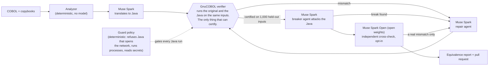

**Demo video (under 3 min): https://youtu.be/ZkujXuDwNSM**

<p align="center"></p>

# Diocle

[](https://github.com/Nivetha200111/Diocle/actions/workflows/test.yml)

**AI writes the code. Diocle checks it against the original, and then attacks it, before anyone has to trust it.**

<p>
  <a href="https://www.meta.ai"></a>&nbsp;&nbsp;
  <a href="https://fireworks.ai"></a>&nbsp;&nbsp;
  <a href="https://www.baseten.co"></a>
</p>

<sub>Built with <strong>Meta</strong>'s models. <strong>Fireworks</strong> and <strong>Baseten</strong> host the open-weights Muse Spark Open. Logos belong to their owners and identify what Diocle uses; no endorsement or partnership is implied.</sub>

Diocle is a verification layer for AI-written Java, starting with COBOL batch programs. Meta's Muse Spark translates the COBOL and repairs the Java; the original, compiled with GnuCOBOL, runs next to the Java on the same inputs, and every output byte, exit code and display line must match, including on 1,000 generated records the agent never saw. Java that passes is then attacked: Muse Spark designs inputs aimed at where it might differ, and a mismatch goes back for repair. A model never certifies; the comparison does. The result is reproducible evidence on the inputs tried under GnuCOBOL, not a formal proof and not a test on IBM Enterprise COBOL. Built for the Meta Global AI Developer Hackathon (Indie track, problem statement **Build for Your World**). All programs and data are synthetic.

| Start here | |
|---|---|
| **Watch** | [The demo video](https://youtu.be/ZkujXuDwNSM) (under 3 min) |
| **Use** | [diocle.vercel.app](https://diocle.vercel.app): press **Try the sample** to re-check stored Java on fresh records (free, no model), or [run it with no key](#run-it-yourself-in-5-minutes) |
| **See** | [Every feature, with screenshots](docs/WALKTHROUGH.md), including VS Code and Muse Code |
| **Read** | [One run end to end](docs/SHOWCASE_CHQCLR.md), [the measurement](docs/MEASUREMENT.md), [each claim and how to check it](docs/CLAIMS_TO_EVIDENCE.md), [the limits](#limits) |

## Why I built this

I have worked on a COBOL modernization project at a global finance company. Reviewing the translated code by hand took so much effort that it drained the project's timeline. AI can now write the Java quickly, but someone still has to decide whether to accept it, and a silent difference repeats on every record (TSB's 2018 migration is the public example of what a bad migration costs, see below). I built the check I wished that project had: run the original and the Java on the same inputs and compare every byte. No code or data from that work is in this repository; every program here is synthetic and written during the hackathon.

**Who it's for.** The modernization lead or systems integrator deciding whether to accept AI-written Java for a nightly COBOL batch program (interest, fees, postings) at a bank, credit union or payment operator. **Today:** hand review or sampling, which eats the timeline and still leaves the question of inputs nobody thought of. **What Diocle automates:** the side-by-side comparison, the attack on Java that passed, the repair of what differs, and a report plus a CI check that anyone can re-run. **What the report lets them decide:** whether this Java matched on these inputs, which checks ran and which did not, and where to spend human review. **What still needs a person or another runtime:** code review, real data, downstream integration, and acceptance on IBM Enterprise COBOL or wherever the program really runs. **Why adversarial inputs:** generated records are well-formed, so they cannot reach dirty fields, and random values rarely hit exact overflow boundaries; that is where the attack found differences. **Why now:** when IBM's shares fell 13.2% in a day over AI COBOL translation (Feb 2026), an IBM spokesperson's answer was that "translating COBOL is the easy part"; Diocle works on the next part, checking the translation against the original. No customer, pilot or adoption is claimed; an [evaluation packet](docs/EVALUATION_PACKET.md) for a prospective user is ready and that validation is outstanding. More in [Why it matters](#why-it-matters) and [Who benefits](#who-benefits).

## The measured finding (15 synthetic programs, one model; [docs/MEASUREMENT.md](docs/MEASUREMENT.md))

- **4 of 10 attackable translations that passed a held-out check of 1,000 generated records then differed from the original under attack.** Muse Spark's Java for CHQCLR, DAYCTRL, INTACCR and TXNPOST matched on that check; Muse Spark, as the breaker, then designed inputs where each one's output differs from the original (run through GnuCOBOL and the Java, not a model's opinion). A gate of 1,000 generated records would have shipped all four; where the breaker can run, Diocle certifies only Java that also survives the attack (it cannot run on every shape: 4 of the 15 programs were certified with no attack). (n = 10 attackable programs, one fresh translation each; a limited attack that finds some differences, not all.)
  - **What the differences are**, by the breaker's stated reasons in that arm (consistent with the records stored in other runs of the same programs). CHQCLR: malformed numeric fields (letters or spaces where `PIC 9` expects digits). DAYCTRL, INTACCR, TXNPOST: the sign of a zero at an exact overflow boundary (`-000000000` vs `+000000000`: same value, different bytes). Across the 54 distinct breaks stored ([list](eval/results-stored-breaks-20261101.json)), 30 are malformed data, 15 negative zero, and 9 are valid records from one round where the Java wrote nothing; **none shows a wrong amount on a well-formed record**. Value errors on well-formed records do occur: in first translations (a balance of 369589314.78 vs 9589314.78), usually caught by the ordinary checks, and in one private-mode Java's printed total, below.
  - **A flaw in the attack itself, found Nov 1:** it compared output records but not display output or exit code. A stored private-mode CHQCLR Java prints `-1200.00` where the COBOL prints `-200.00` on a valid NSF return, and the attack recorded those inputs as no break. Fixed. So in the measurement, "survived" means output records only, and 4 of 10 may be an undercount.
  - **A weakness in the check itself, found Nov 1:** the generator filled CHQCLR's shared REDEFINES body with a placeholder, so that program's "1,000 records" had zero amounts and fees. Fixed for REDEFINES bodies; six of the seven stored Javas then matched on 1,000 valid records with real amounts ([the audit](docs/SHOWCASE_CHQCLR.md)). The other 14 measured programs have no such body. **The same limit remains for flat text records:** see [Not supported yet](#not-supported-yet), including what it means for the Harbor delivery's CI number.
  - **What a count means.** Each check is one run of each program on one generated file. "1,004 of 1,004" counts output records compared, not independent executions; it can differ from the 1,000 random records requested (aggregating and fan-out programs), and a display-only program compares one.
  - Context, with its denominators: Muse Spark's first translation passed 1,000 held-out inputs in **37 of 45 attempts** (82%; 3 per program x 15 programs), and **all 15 programs passed at least once in three tries**. Full Diocle runs certified **14 of 15 programs** (one run each). These count different things: read them as context, not as "model alone vs Diocle".
- About **$0.69** of raw model spend for the whole measurement at list prices (excludes compute, hosting and human review; no comparison with human cost is made).
- Small sample, one model, synthetic programs; the per-program table, caveats and deviations are in the measurement document. CHQCLR's runs disagree (certified on the live site with fix memory on, not certified in the controlled run): [CHQCLR: certified or not?](#chqclr-certified-or-not)

## One public program, not ours: CardDemo's CBCUS01C

Everything above is on synthetic programs we wrote. As a separate check, on Nov 1 we ran `CBCUS01C`, a 178-line customer-file reader from [AWS CardDemo](https://github.com/aws-samples/aws-mainframe-modernization-carddemo) (Apache-2.0, commit `59cc6c2fd7eb`), through conversion and every check that applies to it. **It certified, for $0.0112 and 2 model calls. It is a small program with little logic, and the checks reached only part of it.**

| Check | Result |
|---|---|
| Analyzer, no model | Convertible. So are only 4 of CardDemo's 44 programs; the rest are refused with a reason, mostly CICS and missing copybooks |
| Translate, Muse Spark | Compiled first time, no repair needed |
| Compare with the original under GnuCOBOL | 250 seeded keyed records; final file, all 502 display lines and exit code identical. Repeated on 5 fresh seeds: all pass |
| Guard policy and model review, Muse Spark Open on Fireworks | Policy stopped nothing; review completed: pass |
| Copybook to SQL, SQLite round trip | 205 of 205 records byte for byte |
| Seeded faults | **5 of 40 detected, 35 survived.** Most sit in file-status and abend handling that valid seeded data never reaches; a few change nothing on the status values it sees. Grouped by reading the code |
| Breaker and cross-check | **Not run:** the program writes no output file, and both need one |
| Abend path | **Not reached.** `CEE3ABD` is Diocle's stand-in, not IBM Language Environment |
| Pull request and target-repository CI | **Not run:** delivery targets allowed owners only, and would publish Java derived from CardDemo |

So this shows the pipeline runs on code we did not write and refuses what it cannot check. It does not show CardDemo was migrated: Berkeley DB stands in for VSAM, GnuCOBOL for IBM Enterprise COBOL, and the run is local, not on the public list. No CardDemo code or derived Java is in this repository. Record: [eval/results-carddemo-20261101.json](eval/results-carddemo-20261101.json). To repeat it with your own key (about a cent), from each service's folder: `python -m diocle_analyzer <clone> --samples-dir ../../runs/_carddemo`, then `python -m diocle_converter run ../../runs/_carddemo/cbcus01c --no-memory --breaker --crosscheck --max-usd 0.30`.

## Judge path: three clicks

1. Open [diocle.vercel.app](https://diocle.vercel.app): the first screen is the finding, one catch (on a record with a malformed fee field, the COBOL on GnuCOBOL charged 20.00 and the AI-written Java 0.00), the four steps, the numbers and the limits. Scroll once for CHQCLR's COBOL next to its certified Java and press **Try the sample**: both programs run again on about 1,000 generated records from a seed chosen right then (free, no model call: it re-checks stored Java, it does not convert anything).
2. Open the [CHQCLR run trace](https://diocle.vercel.app/#run=chqclr-20261028-214355): the Java matched on 1,004 held-out output records (weak for this program, the page says why), then 2 of the 10 inputs in the first attack round made it differ (fee 20.00 vs 0.00), the repair agent fixed it, and it matched on 1,006 fresh records and a new attack. A table lists which checks ran and which did not. The whole story, with what can and cannot be reproduced: [docs/SHOWCASE_CHQCLR.md](docs/SHOWCASE_CHQCLR.md).
3. Open [Evidence](https://diocle.vercel.app/evidence) for every run and the cost scoreboard, then [docs/CLAIMS_TO_EVIDENCE.md](docs/CLAIMS_TO_EVIDENCE.md) to check each headline claim in under a minute. Optional: the two live buttons on [Try it live](https://diocle.vercel.app/try) (capped, no input accepted).
4. **No limits, your own key:** the public site is capped so it stays free to run; to convert without any cap, run Diocle locally with your own Meta Model API key ([Quickstart](#quickstart-one-command), about 2.5 minutes and a few cents, or [no key at all](#run-it-yourself-in-5-minutes) to re-verify a certified conversion). Your key stays on your machine.

As of Oct 31, 2026 the public run list had 36 runs (it has grown since with live-button and delivery runs; the current list is on [Run history](https://diocle.vercel.app/runs)), 29 certified (26 excluding 3 labelled live sample runs); median model spend per certified run about 2 cents ($0.0179), mean about 6 cents ($0.0587).

## Run it yourself in 5 minutes

Needs GnuCOBOL 3.2 (`cobc`), JDK 21 and Python 3.11+, or just Docker (below). Tested on macOS and on Linux (Ubuntu 24.04 in Docker); the test suites also run on Linux in CI.

```sh
git clone https://github.com/Nivetha200111/Diocle && cd Diocle
sh scripts/quickstart.sh --check      # checks prerequisites, with an install hint per OS
sh scripts/quickstart.sh --no-key     # no key, no model call: re-verifies a checked-in certified conversion
```

The no-key mode shows that a stored Java still matches the original on fresh records under your own GnuCOBOL and JDK. It is not a new model conversion, and it shows nothing about a Java you have not stored. Measured on a Mac from a clean checkout on Oct 30: about 23 s, 1,027 of 1,027 inputs (most of that is the one-time environment setup). With your own Meta key, see [Quickstart](#quickstart-one-command) (about 2.5 minutes, a few cents). `make test` runs all four suites; CI runs them on every push.

**Linux, or any OS with Docker** (nothing to install but Docker; the image is the engine's own: Ubuntu 24.04, GnuCOBOL 3.2, JDK 21, Python 3.12):

```sh
git clone https://github.com/Nivetha200111/Diocle && cd Diocle
docker build -f deploy/Dockerfile.api -t diocle-quickstart .     # first build compiles GnuCOBOL: several minutes
docker run --rm --entrypoint sh diocle-quickstart -c \
  'git clone -q --depth 1 https://github.com/Nivetha200111/Diocle /tmp/d && cd /tmp/d && sh scripts/quickstart.sh --no-key'
```

Measured Nov 1 (arm64 Docker via Colima, image already built): 13.6 s, 1,027 of 1,027 inputs, no model call. For a real conversion with your own key, put `META_MODEL_API_KEY=...` in `.env` (never on the command line), add `--env-file .env` after `--rm`, and drop `--no-key` (capped at $0.10). Measured Nov 1 the same way: INTACCR certified, 1,027/1,027 held-out inputs, 2 Muse Spark calls, $0.015, 2 min 24 s.

## Important features

Screenshots of each: [docs/WALKTHROUGH.md](docs/WALKTHROUGH.md).

| Feature | What it does | Models and hosts |
|---|---|---|
| **Translate** | COBOL and copybooks to Java; it never certifies | Muse Spark |
| **Differential check** | Original on GnuCOBOL and the Java on the same generated records; every output byte, display line and exit code must match | None: deterministic |
| **Breaker** | Designs inputs aimed at Java that passed, on single-file record programs | Muse Spark; once Muse Wonder |
| **Repair agent** | Uses 7 tools to fix observed mismatches, then re-checked on records it never saw | Muse Spark |
| **Delivery** | A pull request with an equivalence report per program, and CI in the target repository that re-runs the comparison | None at that step |
| **Copybooks as SQL** | `DECIMAL(p,s)` tables from the PICs, checked by a SQLite round trip | None |
| **Private mode, cross-check, guard review** | The agents on open weights; an optional second attacker and final review, thinly tested | Muse Spark Open on Fireworks and Baseten |
| **Read a printout** | A photographed listing back into COBOL, then compared with the original | Muse Wonder |
| **Ask by voice** | A spoken question, answered only from claims GnuCOBOL confirmed | Muse Voice Transcribe, Muse Spark |
| **Editors** | A VS Code extension and a Muse Code plugin, both local | Muse Spark; Muse Code |
| **Evidence** | Run records, a checks table per run, mutation testing, coverage matrix, cost scoreboard | None |

## For engineering, risk and audit teams

Diocle is built around a control a bank already understands: the party that writes the change does not approve it.

| What a reviewer asks | What Diocle provides today |
|---|---|
| Who approved this change? | No model can certify. Only a deterministic comparison with the original can |
| Can we reproduce the result? | Run records keep the seeds and every model call, verification reports keep each input and output, and delivered certificates pin the verifier commit |
| Can someone else re-check it? | The target repository's CI re-runs the comparison on a new seed. It shares the verifier's assumptions, and a flat text record's generated inputs do not change with the seed |
| What wasn't checked? | Run pages and new certificates list which checks ran and which were skipped, plus stated stand-ins |
| What happens to code it can't verify? | It is refused with a reason. Local and admin convert-anyway output is labelled unverified, never certified |
| Where does our code go? | On the public engine it compiles and runs in a sandbox with no network; run locally, it runs on your machine. Model calls go to the host you configure, including open-weights Muse Spark Open on a partner host |
| Can spend run away? | Every model loop has hard call caps. Public buttons, imports, the quickstart and escalation also have dollar caps |

**Not there yet:** no bank has used it, and it has no security audit or compliance certification. Results are under GnuCOBOL, not IBM Enterprise COBOL, on synthetic programs. Running the open weights on your own hardware is untested. A real pilot would start on one low-risk batch program, with the bank's own captured mainframe output.

## How the agents work

- **Translator** (Muse Spark) writes the Java. It never certifies anything.
- **Repair agent** (Muse Spark) works with 7 tools: run the differential test, read the COBOL, read/patch/compile the Java, finish ([repair.py:32](services/converter/diocle_converter/repair.py#L32)). Each round is certified only on held-out inputs from a seed it has not seen ([repair.py:153](services/converter/diocle_converter/repair.py#L153)); lessons it proves are shared with other agents in the same run ([repair.py:181](services/converter/diocle_converter/repair.py#L181)); opt-in escalation to a stronger model tier under its own call and dollar cap ([config.py:77](services/converter/diocle_converter/config.py#L77)).
- **Breaker** (Muse Spark, or Muse Wonder) attacks Java that already passed: up to three rounds of designed inputs, each round run through GnuCOBOL and the Java; if every input matched, the next round is told to attack a different behaviour ([breaker.py:132](services/converter/diocle_converter/breaker.py#L132)). A break sends the Java back to the repair agent. Single-file record programs only; on other shapes it does not run, and the run says so. An example it designed: `RACCT00000200000008NS 1000...`, a returned cheque with a space in its numeric fee: the COBOL on GnuCOBOL wrote fee `20.00`, the Java `0.00`, which turned that run around ([the whole story](docs/SHOWCASE_CHQCLR.md)).
- **Cross-checker and guard** (Muse Spark Open, open weights): a second model, on its own partner host and key, attacks the certified Java with its own inputs (opt-in, not in deliveries, [crosscheck.py](services/converter/diocle_converter/crosscheck.py)), and the guard reviews the final Java and can revoke a certification, never grant one ([guard.py](services/converter/diocle_converter/guard.py)). Both are optional and lightly tested: the review was skipped by the cap on the public sample runs, and the cross-check found no mismatch in its 7 recorded runs (1 public). Neither is counted as an established improvement, and a skipped step is reported as skipped.
- **The judge is not a model.** Only the byte-for-byte comparison with the original compiled by GnuCOBOL certifies. Not every run uses every model or agent; each run's page lists the calls it really made.

## Where Meta models are used

| Model | Role | Evidence strength |
|---|---|---|
| Muse Spark (`muse-spark-1.3-contributor`) | Translator, repair agent, breaker | 34 of 36 public runs; the measurement above |
| Muse Spark Open (open weights, partner inference on Fireworks and Baseten) | Private mode, cross-check, guard review | n=1 public run (INTACCR certified) plus 6 local runs on Nov 1: on CHQCLR and TXNPOST its own Java passed 1,000 held-out inputs and its own breaker broke it; DAYCTRL and FXCONV certified ([results](eval/results-open-weights-20261101.json)); not in the headline measurement |
| Muse Wonder | Read a printout; opt-in breaker tier | n=1 per use |
| Muse Voice Transcribe | Spoken question about a program | One live public ask |
| Muse Code | Local plugin for the agent | Five recorded runs, prompts named the tools |

Not used: Muse Image, SAM 3.1, Muse Glimmer. File paths, run ids and the full table: [docs/META_MODELS.md](docs/META_MODELS.md). No non-Meta model is called by the product.

## Built here vs pre-existing

First commit Oct 27, 2026 (14:46 IST); nothing predates the building period (Oct 27 to Nov 4, 2026). Built here: the analyzer, converter agents, verifier, delivery, API, dashboard, sandbox, extensions and the measurement harness. Pre-existing and used: GnuCOBOL 3.2, Berkeley DB, SQLite, the JDK, web frameworks, fonts, the Meta models and two public COBOL repositories used as test input (the Open Mainframe Project course, CC BY 4.0; AWS CardDemo, Apache-2.0). Detail: [Built during the hackathon](#built-during-the-hackathon-oct-27nov-4-2026) below and [docs/HACKATHON_COMPLIANCE.md](docs/HACKATHON_COMPLIANCE.md) (licences, voice disclosure).

## The name


**Diocle** comes from *Diocles*, the birth name of the Roman emperor [Diocletian](https://en.wikipedia.org/wiki/Diocletian), who ruled from 284 to 305. He inherited a sprawling empire in crisis and reorganised how it was run, including its government, taxes and coinage. *Dioklēs* is a Greek name, [read as](https://en.wiktionary.org/wiki/%CE%94%CE%B9%CE%BF%CE%BA%CE%BB%E1%BF%86%CF%82) "glory of Zeus" or "divine glory".

It suits a project about reorganising old systems, but not everything he did was worth copying. His edict fixing maximum prices in 301 failed, and his reign also brought a persecution of Christians. Decrees did not make the reforms work, and an AI's word does not make a translation right, so Diocle runs the check instead.

<sub>Portrait: fragment of a togate statue of Diocletian, about A.D. 295–300, J. Paul Getty Museum, [CC0 via Wikimedia Commons](https://commons.wikimedia.org/wiki/File:Head_of_Diocletian,_Getty_Museum.jpg).</sub>

<br clear="right">

## Limits

- **Scope: nightly batch, mainly over sequential files**, the jobs that post interest, fees and transactions. Anything Diocle cannot verify (for example EXEC CICS, dynamic CALL) is refused with a reason, never guessed; see [Not supported yet](#not-supported-yet).
- **Synthetic programs only**, for a fictional bank. Nothing is real client code or data.
- **Stand-ins, not the real platforms.** GnuCOBOL 3.2 stands in for z/OS Enterprise COBOL, Berkeley DB for VSAM, SQLite for DB2, and Diocle's own small COBOL routine for IBM Language Environment's `CEE3ABD` abend service. Passing against a stand-in is not passing on the real thing.
- **"Certified" means matched on the tested inputs, not proven equivalent** ([what that means](#what-certified-means-and-does-not)). The tested inputs are PIC boundaries, seeded random values, model-designed attack inputs where the breaker can run, and 1,000 generated held-out records the translating agent never saw. Certified Java can still differ on an input nobody tried: the showcased CHQCLR Java does, on a malformed blank return ([audit](docs/SHOWCASE_CHQCLR.md)).
- **Optional steps can be skipped.** The guard's model review and the cross-check are optional and were often not run or were capped; the breaker does not run on every program shape. Each run page and each delivered certificate states which checks ran, and a skipped check is not a pass.
- **Experimental** (merged, not re-checked on the live site): keyed files, the whole-repository build check, smallest-reproducer extraction, `--document` from the command line. See [docs/LIVE_CHECK.md](docs/LIVE_CHECK.md) and [Not supported yet](#not-supported-yet).

## Before submission and docs map

The demo video link (line 1) and other owner steps are listed in [docs/SUBMISSION_CHECKLIST.md](docs/SUBMISSION_CHECKLIST.md). Architecture: [docs/ARCHITECTURE.md](docs/ARCHITECTURE.md) (diagram; editable [draw.io file](docs/architecture-simple.drawio)). Docs index: [docs/README.md](docs/README.md). Feature manuals: [docs/FEATURES.md](docs/FEATURES.md).

---

# Details

## CHQCLR: certified or not?
Both statements are true and come from different runs with different settings. The live site shows CHQCLR as certified from its Oct 28 frozen-evaluation run (fix memory on, 8 earlier lessons used): 2 of the 10 inputs in the breaker's first round made the Java differ, the repair agent fixed them, and it re-certified on 1,006 fresh records (run `chqclr-20261028-214355`; the run record counts 24 attack inputs with replays). In the Oct 30 controlled measurement (fix memory off, policy-only guard, default caps; run `chqclr-20261030-163002`) the breaker broke 12 of 24 and one repair cycle did not fix it within the caps, so that run is not certified. In the memory-off re-run of the frozen evaluation (`eval-freeze-2`, run `chqclr-20261028-234854`) CHQCLR was certified after the breaker broke 6 inputs and the repair agent fixed them. We did not isolate which setting mattered; three runs of one program do not make a rate.

## Why it matters

In February 2026, after Anthropic said AI could modernize COBOL, IBM's shares fell 13.2% in a day, their steepest drop since 2000
([Reuters via The Star](https://www.thestar.com.my/tech/tech-news/2026/02/24/ibm-posts-steepest-daily-drop-since-2000-after-anthropic-says-ai-can-modernize-cobol)). an IBM spokesperson answered that "translating COBOL is the easy part"
([VentureBeat](https://venturebeat.com/technology/ibms-usd40b-stock-wipeout-is-built-on-a-misconception-translating-cobol-isnt)). The hard part is showing the translation does what the original did. COBOL still handles
about 95% of US ATM transactions (a widely repeated figure from 2017 Reuters reporting), and a wrong migration is expensive: TSB's 2018
core-banking migration locked nearly two million customers out of their accounts, cost the bank £330 million, and brought a £48.65 million
fine from the FCA and PRA in 2022 ([ITPro](https://www.itpro.com/business-strategy/it-infrastructure/369753/tsb-bank-fined-48-million-over-botched-it-upgrade)).
MarketsandMarkets forecasts mainframe modernization spending to grow from about $8.4 billion in 2025 to $13.3 billion in 2030
([press release](https://www.marketsandmarkets.com/PressReleases/mainframe-modernization.asp)). AI makes the rewrite fast; it does not make it safe. The risk is silent: Java that compiles, runs and differs,
by a balance on some records (a first translation here kept digits the COBOL field drops) or by the sign of zero on 30 inputs in a thousand. Diocle's job is to surface that before anyone ships it, on the inputs it tries.

## Who benefits
Diocle is for the teams that inherit COBOL batch programs that move money and cannot afford a silent difference:
- **Credit unions, co-op banks and small banks** whose core batch jobs (interest, fees, postings, reconciliation) are decades-old COBOL, with no budget for a team of mainframe experts to re-check every cent.
- **Benefit, pension and insurance payment operators:** payments are computed by batch programs, and a small difference repeated over millions of records lands on real people. The people who benefit from a verified migration are the ones those programs pay.
- **Modernization teams and auditors:** they get an equivalence report they can re-run themselves (the target repository's CI repeats the check on fresh inputs) instead of a model's opinion. It narrows what a person must review; it does not replace that review or acceptance on the real runtime.

**What changes.** Equivalence is often checked by hand or by sampling. Diocle runs the original and the Java on the same 1,000+ inputs per program, then lets a second agent attack the Java with inputs it designs, and refuses anything that differs. In our runs the median model spend per certified program was about two cents at list prices (mean about six cents; 26 certified runs, excluding the labelled live sample runs, read from the public run list on Oct 31, 2026). That is raw model spend only: compute, hosting and human review are not measured, a certified run took minutes of elapsed time (the three-program delivery in the video 26 minutes), and none of it is the cost of a migration (see the scoreboard on [/evidence](https://diocle.vercel.app/evidence)). The mean moves as runs are added.

**Usable today** (no claim of adoption: this is what exists): the live site and its two live buttons; one command that certifies a sample with your own Meta key (about 25 seconds with no key (23 s measured), about 2.5 minutes with one; see [Quickstart](#quickstart-one-command)); a VS Code extension and a Notepad++ script (the extension can be packaged to a `.vsix` with `npm run package`; it is not published to a marketplace); delivery of a whole repository as a pull request into a new private repository, with CI that re-verifies each program ([Let Diocle create the target repository](docs/FEATURES.md#let-diocle-create-the-target-repository-local-or-admin-only)).


## Evidence and development tools

- **Evidence, with links to every run:** [diocle.vercel.app/evidence](https://diocle.vercel.app/evidence), [docs/EVIDENCE.md](docs/EVIDENCE.md) (the canonical delivery, [quillmark-modern#4](https://github.com/Nivetha200111/quillmark-modern/pull/4), with its CI) and [docs/EVALUATION.md](docs/EVALUATION.md) (unseen programs, failures included).
- **Bring your own repository:** open [Delivery](https://diocle.vercel.app/delivery) and paste any public COBOL repository (small daily budget; every compile and run of imported code happens in a sandbox with no network and no credentials, while cloning, analysis and the model calls run in the engine).
- **Commit history:** [github.com/Nivetha200111/Diocle/commits/main](https://github.com/Nivetha200111/Diocle/commits/main), [docs/BUILD_LOG.md](docs/BUILD_LOG.md).

## Built during the hackathon (Oct 27–Nov 4, 2026)

**Built here** (the first commit is Oct 27, 2026; everything below was written during the building period):
- **Analyzer:** COBOL and copybook parsing, record layouts (packed, zoned, binary, REDEFINES, OCCURS, COPY REPLACING), file and JCL wiring, CALL resolution, risk flags and the "not convertible, with a reason" rules.
- **Converter agents (Meta models only):** translator, tool-using repair agent, breaker agent, independent cross-check, guard (deterministic policy plus optional model review), proof-gated fix memory, swarm mode, escalation tiers, convert-anyway and bounded COBOL self-repair, transcription of a printed listing (Muse Wonder).
- **Verifier:** the differential-testing oracle (GnuCOBOL original vs Java, byte for byte, 1,000 held-out inputs), golden-file replay with an EBCDIC codec, copybook-to-SQL schema with a SQLite round trip, the DB2 subset (`db2-subset-1`, SQLite stand-in) and keyed-file subset (`ksds-subset-1`, Berkeley DB handler), mutation testing, smallest-reproducer minimizer, whole-repository build check.
- **Delivery:** a legacy repository becomes a pull request with an equivalence report, with generated CI that re-verifies on fresh inputs; create-target repository mode.
- **API, dashboard and sandbox:** the FastAPI service, the Next.js dashboard (home, mission control, evidence, bug of the day, live runs, delivery), the two public live buttons, the voice question, and the no-network sandbox container.
- **Extensions and tooling:** MCP server, VS Code extension, Notepad++ script, quickstart script, evaluation and measurement harnesses.
- **Samples and docs:** all synthetic COBOL samples and the evaluation programs.

**Already existed and is used, not built here:** GnuCOBOL 3.2 (the compiler we compare against), the JDK, Berkeley DB and SQLite, the Meta models and Meta Model API (Muse Spark, Muse Wonder, Muse Spark Open, Muse Voice Transcribe), Fireworks and Baseten hosting for Muse Spark Open, Next.js, React, FastAPI, Docker and Caddy, Vercel and Vultr hosting, GitHub and GitHub Actions, Remotion, Playwright, ffmpeg and whisper.cpp (video tooling only), and two public COBOL repositories imported through the live import button as test input, not vendored: the Open Mainframe Project course (CC BY 4.0, credited on the Evidence page) and AWS CardDemo (Apache-2.0). The demo video's narration is the author's own recorded voice.

## Which model does what

Meta models used (file paths and evidence per model: [docs/META_MODELS.md](docs/META_MODELS.md)): Muse Spark (Meta Model API) as translator, repair agent and breaker; **Muse Wonder** reads a photographed or printed COBOL listing back into COBOL that is then verified against the original, and can act as the breaker agent; **Muse Spark Open** (open weights, partner inference on Fireworks) is the independent cross-checker, the guard agent's model review (it can only revoke a certification, never grant one) and the private mode; **Muse Voice Transcribe** transcribes the spoken question. No other model is used in the product. The converter depends on the `openai` Python package only as an OpenAI-compatible HTTP client: its base URL is the Meta Model API (`https://api.meta.ai/v1`) or the Muse Spark Open host, set in `.env`; no OpenAI model is called.




| Role | Model | Served by | What it may do |
|---|---|---|---|
| Translator, repair agent, breaker | Muse Spark (`muse-spark-1.3-contributor` by default) | Meta Model API | Write and patch Java, design attack inputs. Cannot certify. |
| Independent cross-check (`--crosscheck`, opt-in) | Muse Spark Open | Partner host (Baseten or Fireworks) | Propose inputs where it thinks the Java differs. Every input runs through GnuCOBOL and the Java; its opinion certifies nothing. |
| Guard review (optional) | Muse Spark Open | Partner host (Fireworks on the live engine; Baseten example in `.env.example`) | One review of the final Java; can only revoke certification, never grant it. |
| Escalation tiers (`--tiers`, opt-in) | Muse Spark contributor, then `muse-spark-1.3`, then `muse-wonder-1.0` | Meta Model API | The repair agent moves up one tier after each failed certification round and the breaker attacks at tier 2 by default (Muse Wonder is opt-in with `MODEL_TIER_BREAKER=3`); hard caps on calls and dollars above tier 1. Not yet shown to repair better than tier 1 alone. |
| Private mode | Muse Spark Open replaces Muse Spark in all three agent roles | Partner host | Same loop on open weights. The one live run (n=1) used partner inference on Fireworks, so it did not keep code on hardware you own; running the open weights on your own hardware is possible but was not tested here. |
| **Verifier** | none, it is GnuCOBOL and a byte-for-byte comparison | Sandbox (no network, no credentials) | **The only thing that certifies.** |

The guard's deterministic policy runs on every run. Its model review is configured on the live engine, but in all three public live sample runs it was skipped by the run's $0.02 dollar cap (the run record says so), so no completed review appears in the public run list; there the policy and the verifier decide. The narration of the demo video is the author's own recorded voice; Meta's speech model on the API (`muse-voice-transcribe-1.0`) transcribes speech and does not speak.

## What "certified" means, and does not

- **Means:** on every input tried (PIC boundaries, seeded random values, fixtures, corpus records, model-designed attacks and 1,000 held-out inputs), the Java's output records, display output and exit code equal those of the original COBOL compiled with GnuCOBOL 3.2 under IBM's TRUNC(STD) and DISPLAY defaults, or equal the mainframe's own captured output where golden files exist. CI repeats this with a seed Diocle never used.
- **Does not mean:** equivalence for every possible input (testing cannot show that), or equivalence to IBM Enterprise COBOL where GnuCOBOL differs from it and no mainframe output was captured. The demo golden files were produced by GnuCOBOL, so they exercise the replay path but are not mainframe evidence. CI reuses Diocle's verifier, so it shares its assumptions; it guards against tampering and lucky seeds, not against a flaw in the verifier itself.

## How this relates to other work

Vendors already generate Java from COBOL (for example IBM watsonx Code Assistant for Z, which also offers validation). Diocle's focus is narrower and open: a repair agent driven by executable evidence, equivalence reports that pin every input to the result, delivery as an ordinary pull request, an independent CI re-run anyone can inspect, and the ability to audit conversions produced by any tool ("bring your own conversion").

- **Judging translations without running them.** IBM Research's evaluation of watsonx Code Assistant for Z's COBOL-to-Java output ([Froimovich et al., arXiv:2507.23356](https://arxiv.org/abs/2507.23356)) uses static checkers (variable-access, procedure-call and middleware-call matching, hallucination flags) and an LLM-as-a-judge on a 1-7 scale, and notes that proving two programs equivalent is undecidable. It does not report running the Java against the original COBOL. Diocle takes the other route: it runs both on the same inputs and compares every output byte, and a model only writes and repairs code, never judges it. Per-program proof matters because errors compound: if each of ten paragraphs is right 90% of the time, the whole program is right only about a third of the time (0.9¹⁰ ≈ 0.35), the paper's own illustration.
- **GnuCOBOL off the mainframe.** Bankdata and the University of Southern Denmark ([Askholm, Johnsen and Mauro, arXiv:2604.00936](https://arxiv.org/abs/2604.00936)) report a bank running GnuCOBOL in GitHub Actions for COBOL testing. The paper does not address where GnuCOBOL differs from IBM Enterprise COBOL; Diocle pins those differences (IBM TRUNC(STD) and DISPLAY defaults, EBCDIC collation) and replays captured mainframe output where it exists.
- **Parallel run.** The method is the "parallel run" migration pattern (Sam Newman, *Monolith to Microservices*): run old and new side by side and compare results. Diocle makes it automatic, per program, before the code ships, and again in the target repository's CI.

All code here was written during the Meta Global AI Developer Hackathon (building period Oct 27 to Nov 4 2026); nothing predates Oct 27. All COBOL and data are synthetic, for a fictional bank (Quillmark Trust & Savings).

## What runs today

<p align="center"></p>

| Part | What it does |
|---|---|
| `services/analyzer` | Deterministic, no model calls. Derives record layouts from copybooks (DISPLAY, COMP-3, COMP, COMP-5, COMP-1/2, all sign modes, P scaling, OCCURS, REDEFINES, edited PICs, COPY REPLACING), wires files through SELECT/FD/OPEN and JCL, resolves CALLed programs, and flags legacy behaviour: ROUNDED, truncation, silent overflow, code cut at column 72, clock reads, EBCDIC-sensitive comparisons, hex floats. Imports GitHub repositories: any public one for visitors (everything runs in an isolated sandbox), allowed owners for pull-request delivery. |
| `services/verifier` | The oracle. Compiles the COBOL with GnuCOBOL 3.2 (-std=ibm, plus IBM's TRUNC(STD) and DISPLAY defaults), runs both sides on boundary, random, fixture, corpus and model-designed inputs, and compares field by field and byte by byte, for one or several input and output files (match-merge, SORT USING/GIVING): text and fixed-length records, packed and binary data, RETURN-CODE, stdout, a pinned clock, EBCDIC collation. Golden-file replay judges the Java against captured mainframe output, with a layout-aware EBCDIC and IBM hex-float codec. `reverify` re-checks a delivery in CI. `sqlschema` turns the copybooks into SQL tables (`DECIMAL(p,s)` from the PIC, REDEFINES and OCCURS stated) and checks them by a round trip through SQLite that must return every record byte for byte; no model. |
| `services/converter` | Meta models only (Muse Spark hosted, or Muse Spark Open on Fireworks or Baseten). Translator, tool-using repair agent, breaker agent that designs inputs to break certified Java, guard agent (a deterministic policy that runs on every run and refuses to run Java that openly uses the network, processes, reflection, other environment variables or literal outside paths, a speed bump in front of the sandbox; and an optional Muse Spark Open review of certified Java that can revoke certification for leaks or test gaming; configured on the live engine, skipped by the cap on the public sample runs), proof-gated fix memory, swarm mode (parallel agents share certified lessons mid-run), skill export. Hard caps on calls, rounds and attack cycles. |
| `services/api` | Serves runs and deliveries to the dashboard; `deliver` turns a legacy repo into a certified pull request on a target repo. |
| `services/mcp` | Diocle as an MCP server: `analyze_cobol`, `verify_conversion`, `certify_conversion`, `cobol_lessons`, so any agent's conversion can be checked. |
| `apps/web` | Dashboard, one sidebar on every page. Start here: **Home** (COBOL next to certified Java, re-verify on a fresh seed), **Try it live** (`/try`: convert a sample, read a printout, ask by voice), **Import a repository** (`/delivery`). Watch: **Current run** (`/now`: whatever the engine is running right now), **Agent replay** (`/mission`: one recorded run step by step). Proof: **Run history** (`/runs`: agent trace, Meta model per role, before/after, cost), **Evidence**, **Bug of the day**. All show real data; other views, only in local builds, are a labelled mock. |
| `samples/`, `eval/samples/` | Synthetic COBOL only. `samples/` has 18 folders: 14 with a `sample.json` that the verifier runs end to end (for example INTACCR, TXNPOST, FEESCHD, DAYCTRL, PKDPOST with a golden set, ACCTMTCH match-merge, and the DISPLAY-only, OPEN I-O and CALL identifier shapes TXNLIST, LDGRWRT, FEEPOST), three refused on purpose (`convert-anyway-repo`, `db2-dynamic-sql`, `vsam-alternate-key`) and one data folder (`quillmark`). `eval/samples/` holds the four unseen evaluation programs (BRNCHSUM, CHQCLR, FXCONV, LOANAMRT). |

Sample estate repositories: [quillmark-mainframe](https://github.com/Nivetha200111/quillmark-mainframe) (a z/OS library export) → [quillmark-java](https://github.com/Nivetha200111/quillmark-java) (certified Java, re-verifying CI); and [quillmark-legacy](https://github.com/Nivetha200111/quillmark-legacy) (COBOL in) and [quillmark-modern](https://github.com/Nivetha200111/quillmark-modern) (certified Java out, with re-verifying CI).

### More feature detail

The live buttons, the voice question, embedded SQL, keyed files, mutation testing, the smallest reproducer, the whole-repository build check, create-target delivery and running on your own repo are documented in [docs/FEATURES.md](docs/FEATURES.md).

### Verified documentation

`python -m diocle_converter run SAMPLE --document` (or `document SAMPLE` on its own) has a Muse Spark model write a plain-English behaviour spec of a COBOL program as claims, each with concrete examples (input records and expected output fields). The original COBOL, compiled with GnuCOBOL and run in the sandbox, then decides every claim: **confirmed on the examples tried** (the examples' stated expectations held on GnuCOBOL; the claim's sentence itself is not machine-checked, and numbers are compared by value, not byte for byte), **refuted** (the actual value is kept and shown) or **unchecked** (invalid example, the program did not run or ended with a return code the example does not expect, or the expectation compares nothing but a record count or return code). The model never decides, and "confirmed" is not "proven". Wrong claims are caught and shown, not hidden. The dashboard shows it as the Behaviour spec panel with a Markdown download. Contract: `contracts/behavior-claims.schema.json`. Single-file record programs only; opt-in, capped (2 calls, $0.10) and never fails a run. The same claim-checking path runs live behind the "Ask the original program" panel (checked Oct 30, 2026); the `--document` command line itself and the Markdown download were not re-run live.

## Measured so far (pilot evidence: synthetic programs, small samples; costs are estimates from list prices)

- **Canonical delivery: [quillmark-modern#4](https://github.com/Nivetha200111/quillmark-modern/pull/4).** Six Quillmark programs (including a packed fixed-length extract and a two-input, two-output match-merge), translated from scratch by Muse Spark, all certified under one pinned byte-exact verifier, then re-verified by the target repository's GitHub CI on **6,719 fresh inputs with 0 differences** ([CI run](https://github.com/Nivetha200111/quillmark-modern/actions/runs/40811476870)). About $0.13 of model spend for the six conversions.
- **Correction (Oct 28).** An independent review showed the comparator paired output records with inputs and compared numeric fields by value, so `+00` and `-00` counted as equal. It now compares the whole output sequence byte for byte. Re-checking every certified run found one that should not have passed: the INTACCR in the earlier quillmark-modern#3 writes `-000000000` where the COBOL writes `+000000000` on 30 of 1,019 inputs. INTACCR was converted again (the repair agent fixed the negative-zero case itself) and the other five programs were re-certified under the new verifier at zero model calls; that is #4.
- **Unseen programs:** the frozen evaluation certified 2 of 4; both failures were the old comparator rejecting aggregation and fan-out. Re-run with the corrected verifier and fix memory off: **4 of 4 certified for about $0.11**, each passing five fresh seeds ([docs/EVALUATION.md](docs/EVALUATION.md)).
- **Copybooks as SQL:** for all 11 sample and evaluation programs (24 tables), generated records (PIC boundaries and seeded random values) fit the published column types and come back from SQLite byte for byte; so do PKDPOST's golden files after EBCDIC conversion. The front page and Run history show each run's `schema.sql` next to its Java.
- **Breaker agent:** on CHQCLR it made Java differ that had matched on 1,004 held-out output records (fee 20.00 vs 0.00, on a malformed record); the repair agent fixed it and it matched on 1,006 fresh ones (the Oct 28 run, fix memory on; the later memory-off measurement run was not certified, see [CHQCLR: certified or not?](#chqclr-certified-or-not)).
- Fix memory over 18 runs on three programs: 30% lower cost and 37% less model time on average than without memory. This is a pilot (single runs vary, not a controlled comparison); the headline measurement ran with fix memory off.
- Costs are estimates from list prices.

## Coverage today: what Diocle verifies, and what it does not
By kind of mainframe artifact, as of Oct 30, 2026 (also on the [Evidence page](https://diocle.vercel.app/evidence)). "Experimental" means merged but not verified live; certified always means matched on the inputs tried.

| Artifact | Status | What is checked | Limit |
|---|---|---|---|
| Sequential files (QSAM-style) | Verified | Outputs compared byte for byte, original on GnuCOBOL against the Java, plus 1,000 held-out inputs | On the inputs tried |
| Copybooks (COPY, REPLACING) | Verified | Layouts come from the copybooks; verification and SQL schemas derive from them | Copybooks outside the repository refuse the program with a reason |
| Static CALLs between programs | Verified | Called programs are translated together and linked into one executable | Dynamic CALLs and calls to programs not in the repository are refused (except `CEE3ABD`, below) |
| JCL jobs | Partial | One SORT step feeding one COBOL step, with DD overrides: every final dataset compared | Runs through the converter's `run-job` command, not the web delivery flow; longer jobs, several SORT steps, COND-gated steps and IDCAMS are refused with a reason |
| Abnormal end through IBM LE (`CALL 'CEE3ABD'`) | Stand-in | The original is linked with Diocle's stated stand-in (ends the run at the CALL with exit code 16, keeps DISPLAY output and records already written); exit code, stdout and files compared; the verification report names the stand-in (`runs.standIns`) | Verified against GnuCOBOL with Diocle's CEE3ABD stand-in, never IBM LE (a real abend has no return code and may lose buffered records); generated inputs rarely reach an abend path. Other LE services (CEEDAYS, CEELOCT, ...) and site utilities are still refused |
| Embedded SQL (DB2) | Subset | A named subset (SELECT INTO, INSERT, UPDATE, DELETE, cursors, COMMIT, ROLLBACK, SQLCODE), final table contents compared | On a SQLite stand-in, never real DB2; dynamic SQL, joins and DB2-only clauses are refused |
| Keyed files (VSAM KSDS-style) | Experimental | A keyed-file subset compared by key order on GnuCOBOL's indexed-file handler | Merged and the engine has the indexed handler (`cobc --info`: BDB), but no keyed conversion was run on the live site; Berkeley DB, not IBM VSAM |
| Whole-repository build check | Partial | Compiles every converted program together, flags copybook drift and CALL signature mismatches, and puts a build report in the pull request | Experimental: merged, not checked on the live engine, CI step not yet run on GitHub; JCL step order not checked; customer domain classes are an experimental compile-time check only |
| Hierarchical database (IMS DL/I) | Not supported | There is no free IMS runtime to compare against | Roadmap |
| CICS online transactions | Not supported | Programs with EXEC CICS are refused with a reason | |

### Whole JCL job verification v1: one SORT step feeding one COBOL step

`python -m diocle_converter run-job SAMPLE_WITH_JCL` converts a JCL job of one shape end to end: one SORT step (`SORT FIELDS=` with character keys, optional `OPTION EQUALS`) feeding one COBOL step. The COBOL step is translated by the Meta model (one call, as in `run`); the SORT step and the job driver are generated deterministically with no model call; the job is run both ways through the same DD-to-file wiring and every final dataset is compared. Every other job shape is reported as not convertible with a reason (see [Not supported yet](#not-supported-yet)). The job check is not wired into the web delivery flow.

## Not supported yet

Every known limit, one row each. Nothing in this table is claimed to work.

| Limit | Why | Workaround | Status |
|---|---|---|---|
| Delivered Java for embedded-SQL programs does not compile on its own; the same holds for keyed-file programs | It calls `DioSql` (or `DioKsds`), the verifier's support classes in `services/verifier`, which are not part of the delivered programs | The whole-repository check and the generated CI add `DioSql.java` from the pinned Diocle commit; copy the class in by hand to build a delivered SQL program (for example HRGLP060) from its own files | Documented limitation, not fixed in this release |
| Shapes reported as not convertible: EXEC SQL outside the verified subset (dynamic SQL, stored procedures, joins, DB2 functions and special registers, FETCH FIRST, WITH UR, FOR UPDATE, WHERE CURRENT OF, multi-row operations, LOB/DATE/TIMESTAMP columns, no schema source); CICS or DLI; RELATIVE files and INDEXED files outside `ksds-subset-1` (alternate keys, duplicates, locking, EXTEND, group/signed/packed keys, no FILE STATUS); LINE SEQUENTIAL files opened I-O; a file opened I-O in one place and another way elsewhere; CALL identifiers that anything other than literals can assign (STRING, UNSTRING, ACCEPT, READ INTO, a LINKAGE parameter, a MOVE from a field, a second literal); DISPLAY-only programs that ACCEPT from the console or DISPLAY only UPON SYSERR; programs with no output file and no DISPLAY; a JCL job whose COBOL step is DISPLAY-only or updates a file in place (the job check compares output files only); several record types in one file; OCCURS DEPENDING ON; SYNCHRONIZED; PIC N; leading P scaling | The verifier cannot run them against GnuCOBOL. The subset that is verified runs on a SQLite stand-in, not DB2; real IBM VSAM, IDCAMS and alternate indexes are never covered; the keyed subset is experimental (the production sandbox has the Berkeley DB handler but no keyed conversion was run there) | Convert anyway (local or admin only, next row) gives labelled, unverified Java | Refused with a reason. Each new shape we found unhandled was added here with a test; there may be others |
| Convert anyway never certifies what the verifier could not run | Programs the analyzer refuses (EXEC SQL outside the subset, CICS/DLI, keyed files outside the subset, dynamic or external CALLs, missing copybooks, no output) get labelled `// ADAPTER REQUIRED` interfaces (no invented database behaviour), are compile-checked with `javac`, never executed, and labelled `COMPILED, NOT VERIFIED`; nothing here is a working DB2, CICS or keyed-file conversion. An original that does not compile under GnuCOBOL gets a bounded patch first (the rule is in [Running on your own repo](docs/FEATURES.md#running-on-your-own-repo-local-your-own-key)) and its Java is labelled `VERIFIED AGAINST REPAIRED COBOL`, which is not `CERTIFIED` | Review the labelled Java by hand | Local or admin only; visitor imports on the public site cannot enable the mode and keep refusing |
| A program whose original COBOL does not compile under GnuCOBOL `-std=ibm` (for example a missing period after `PROGRAM-ID`, which IBM's compiler accepts) cannot be verified | The oracle is GnuCOBOL; Diocle does not repair or rewrite the original so that it compiles | Visitor imports find this before any model call with a compile-only check in the sandbox, skip the program with the compiler's reason and give its slot to the next compilable program (at most 12 checked per import; skipped if the sandbox is unavailable). Other paths (CLI runs, owner deliveries) find it only after the first translator call, where the run stops with that reason | Known limitation |
| DISPLAY-only and OPEN I-O programs are accepted from what the source says, not from a run | A program whose DISPLAY (or REWRITE) never fires on the generated inputs, or that prints something nondeterministic such as `FUNCTION RANDOM`, cannot certify, and this is found only at verification time, after the translator call has been paid for | Both shapes have been through real Muse Spark conversions in the headline measurement ([docs/MEASUREMENT.md](docs/MEASUREMENT.md)): TXNLIST (display-only) passed 3 of 3 first translations and was certified, LDGRWRT (OPEN I-O) passed 1 of 3 and was certified after one repair round, FEEPOST (CALL identifier) passed 3 of 3 and was certified. A display-only program is compared on one run of its output (TXNLIST compared 1 case), not on a thousand inputs | Supported, with these limits |
| JCL jobs convert end to end in one shape only | One SORT step (`SORT FIELDS=` with character keys, optional `OPTION EQUALS`) feeding one COBOL step. Jobs with three or more steps, several SORT steps, COND-gated steps, numeric (ZD/PD/BI) sort keys, INCLUDE/OMIT, INREC/OUTREC, SUM or MERGE are reported as not convertible with a reason | The job-level check runs through the converter CLI (`python -m diocle_converter run-job SAMPLE_WITH_JCL`, which calls `diocle_verifier.jobs.verify_job`) | Partial; not wired into the web delivery flow |
| `CALL 'CEE3ABD'` is checked against Diocle's stand-in, not IBM Language Environment | On z/OS an abend has no return code and buffered records may be lost; the stand-in fixes one documented behaviour (exit code 16 at the CALL, open files closed as at STOP RUN, `CEE3ABD abend code <n>` on stderr, which is not compared) and the Java must match it. Generated inputs reach abend paths only when the data can trigger them (CardDemo's batch programs abend on file-status errors, which generated data never causes) | The stand-in is `services/verifier/diocle_verifier/standins/CEE3ABD.cbl`; a repository that ships its own CEE3ABD program uses that instead | Stand-in, stated in the verification report (`runs.standIns`), and since Nov 1 in the run record, certificate `scope`, pull request text and run page; the JCL job report (`jobs[].runs`) does not carry it |
| Without golden files the oracle is GnuCOBOL, not IBM Enterprise COBOL | GnuCOBOL can differ from IBM in edge cases (intermediate precision, NUMPROC, hex float arithmetic) | Golden-file replay judges the Java against captured mainframe output where it exists | No real mainframe output has been tested yet |
| SQL schemas are checked on SQLite only | Alphanumeric fields that carry binary bytes (LOW-VALUES, a REDEFINES over packed data) would need BYTEA/BINARY in PostgreSQL or DB2, and a record type split behind a REDEFINES is kept as the shared bytes, not as typed columns per variant | None | Known limitation |
| The breaker agent attacks single-file programs only | Its input design is per record layout. In the frozen evaluation it broke CHQCLR after the program had matched on 1,004 held-out output records (fee 20.00 vs 0.00 and debit -121.23 vs 0.00; fixed and re-certified); both records carry malformed numeric content (a leading space, letters in a numeric field), so this shows agreement with GnuCOBOL's handling of bad data, not IBM behaviour. On other shapes (ACCTMTCH, ACCTRPT, LDGRWRT, TXNLIST in the measurement) no attack runs and the run page says "not run" | None | Known limitation |
| Generated records carry no deliberately bad data, and some record shapes get placeholders | Bad data is exercised only by what the breaker designs. **Flat text records** (one `PIC X(n)` field) get a counter that does not change with the seed: in the Harbor delivery, [harbor-trust-mainframe-java#2](https://github.com/Nivetha200111/harbor-trust-mainframe-java/pull/2), 18 of the 19 programs' generated records give one identical `REJECT` line each, so those programs were exercised during conversion by records taken from the repository's data files (400 for the 14 single-file ones) and, where it could run, the breaker. Its CI, which has only the generated records, re-checks little for them; the 19th, HTDBDEF, prints a placeholder line. That delivery's whole-repository build check also reports FAIL on CALL argument mismatches, and its pull request says so. A body shared by REDEFINES got the same placeholder until Nov 1 (CHQCLR among the samples; [audit](docs/SHOWCASE_CHQCLR.md)); multi-file, job and keyed paths still do not fill views. Stored counts for affected runs are labelled | The breaker where it can run; your own `corpus` or `fixtureCases` in `sample.json` | REDEFINES fixed for single-file programs (live since the Nov 1 engine deploy); flat records are a known limit |
| Mutation testing (verification strength) covers single-input, single-output record programs only | No coverage tool (mutants in code the layouts never reach show up as survivors), a fixed operator set, extra inputs built from the base record layout only (REDEFINES views are not varied, so CHQCLR got just 6 extra inputs), capped at 40 mutants and a wall clock | Ran live once in [docs/LIVE_CHECK.md](docs/LIVE_CHECK.md) (CHQCLR, Oct 30, 2026: 14 of 35 seeded faults detected, 21 survived, 5 did not compile); a survivor is a coverage question, not a verdict | Experimental beyond that one run |
| Verified documentation covers single-file record programs only | Multi-file, DISPLAY-only and I-O programs are skipped; it checks only the examples a model wrote | The claim-checking path ran live behind the "Ask the original program" panel on Oct 30, 2026; the `--document` command line and the Markdown download were not re-run live | Experimental |
| The voice question covers two bundled single-file programs on the public site and any single-file record program locally | The speech model sometimes mishears (one real run heard "the fee the fee"), a weak transcript yields weak claims, and the answer is only as good as the examples GnuCOBOL confirmed. The speech route is Meta's client protocol, not a documented API. The microphone path was verified only up to the engine (encoder output and upload), not with a real microphone | Use `--text` locally to skip transcription | Live (one public ask checked Oct 30) with these limits |
| The whole-repository build check is a compile and interface check only | It does not run the programs together, does not follow JCL step order or dataset wiring, and compares CALL argument lengths only for plain 01/77 items. Domain classes (`--domain-classes`) are compile-time only | Each program is still verified alone | Experimental; not checked on the live engine |
| The live buttons convert one fixed program and read one fixed printout | There is no way to try your own code through them. On the Convert button the guard model's review (Fireworks) is skipped by the $0.02 cap and says so in the run ("review skipped: the run's dollar cap was reached"); the verifier's result is unaffected | Use a visitor import on the Delivery page, or run it locally | By design (cost caps, no free-text input) |
| The VS Code extension (`editors/vscode`) runs the local converter only | No engine mode, no Marketplace listing; needs a Diocle checkout for the converter, GnuCOBOL and a JDK; converts one file at a time. Exercised in a real VS Code extension host for `check` and `convert`; Cursor, VSCodium and Windsurf were not run | Package it with `npm run package` and install the `.vsix` | Local tool, not published |
| The Muse Code plugin (`editors/muse-code`) works on paths inside a Diocle checkout and converts the bundled samples only | Five real model-driven runs are recorded (Oct 31) but their prompts named the tools; how the agent behaves with the skill alone, and whether Muse Code runs the MCP tools unattended, is untested | See `editors/muse-code/README.md` | Local plugin, not published |

## Run

**Tests.** `make test` (or `sh scripts/test.sh`) installs each service and runs all four suites; `--fast` skips the tests that need GnuCOBOL and a JDK. The GitHub Actions run (badge above) executes everything on every push: analyzer, verifier, converter and api suites with GnuCOBOL 3.2, Berkeley DB and JDK 21. On a green run two tests are skipped, and neither hides a failure: one converter test needs macOS's `sandbox-exec` (so it is skipped on Linux), and one API test needs a certified INTACCR run record that exists only on the owner's machine.

### Quickstart (one command)

```sh
sh scripts/quickstart.sh --no-key     # no key, no model: re-verify a checked-in certified conversion, seconds
cp .env.example .env                  # then set META_MODEL_API_KEY= (your own Meta key); never pass it as an argument
sh scripts/quickstart.sh              # one real, capped conversion of a small sample (default cap $0.10)
```

It checks GnuCOBOL 3.2+, JDK 21+ and Python 3.11+ (with an install hint per OS), builds one venv, and prints the
CERTIFIED line, the inputs behind it, model, tokens, estimated cost and where the Java and run record were written.
Without a key it falls through to the no-key mode and says that no model was called. `QUICKSTART_MAX_USD` raises the
cap (hard maximum $1.00); `--sample NAME` picks another sample (no-key mode needs a `certified-java/` folder, only
`interest-accrual` has one). Measured on a Mac from a clean clone: no-key mode about 25 s including the one-time venv (re-measured Oct 30 on a clean checkout; 2 s of that is the verification, the rest is installing the environment and varies with your network), key mode about 2.5
minutes (model time dominates) and about $0.003 to $0.015 for one INTACCR conversion; times vary with the model host. On Linux use the Docker commands in [Run it yourself in 5 minutes](#run-it-yourself-in-5-minutes) (tested Nov 1 on Ubuntu 24.04 in Docker).

Needs GnuCOBOL 3.2 (`cobc`), JDK 21 and Python 3.11+. Each service has its own README with setup and test commands. Model keys go in `.env` (see `.env.example`); nothing secret is committed.

### Using your own Meta key

Judges do not need a key: the live site, **Try the sample** and the public re-verify run on our engine. To run the
converter yourself:

1. Create an API key for the Meta Model API in your Meta developer account at [dev.meta.ai](https://dev.meta.ai).
2. `cp .env.example .env`, then set `META_MODEL_API_KEY=` (the base URL `https://api.meta.ai/v1` and the model
   `muse-spark-1.3-contributor` are already filled in; use `muse-spark-1.3` for anything private).
3. Optional, for private mode or the independent cross-check: set `OPEN_MODEL_API_KEY`, `OPEN_MODEL_BASE_URL` and
   `OPEN_MODEL_ID` (Fireworks and Baseten examples are in `.env.example`).
4. Check the key and endpoint: `cd services/converter && .venv/bin/python -m diocle_converter smoke` (one tiny call,
   about a hundredth of a cent). A first full run on a sample costs a few cents; every model loop has hard call caps
   (`MODEL_MAX_CALLS_PER_RUN` and the others in `.env.example`).

See [CLAUDE.md](CLAUDE.md) for contributor rules and [docs/ARCHITECTURE.md](docs/ARCHITECTURE.md) for the design.

## Editors

- **VS Code and forks** (Cursor, VSCodium, Windsurf): `editors/vscode` checks that a COBOL file compiles under GnuCOBOL (errors in the Problems panel) and converts and verifies it from the editor with your own Meta key on your machine, capped in dollars; results carry the same honest labels as the dashboard. See `editors/vscode/README.md`. Add `.diocle/` to your `.gitignore` (results are written there). Not published to a marketplace yet.
- **Muse Code** (Meta's coding agent): `editors/muse-code`, a local plugin (stdio MCP server in standard-library Python, a skill and four slash commands): analyze, re-verify against GnuCOBOL, read runs, and a gated, capped `diocle_convert` that is off by default and uses your own key. Tested with Muse Code 1.4.14 on macOS: validation, install, approval and the server handshake (7 tools) were seen in the real binary; **five real model-driven Muse Code runs are recorded** (Oct 31): Muse Code picked and called the tools and reported their output (the prompts named the tools, and conversion was enabled and capped by the owner), including a capped conversion that certified INTACCR 1027 of 1027 for an estimated USD 0.017, and it was refused outside the repo and when conversion was not enabled (transcripts in `editors/muse-code/transcripts/`). A local plugin, not an official Meta integration, not published. See `editors/muse-code/README.md`.
- **Notepad++** (Windows): `editors/notepadpp`, a PythonScript plugin script (or NppExec scripts) around the same CLI: check with annotations on the reported lines, convert with a cost prompt and the same honest labels. Built on macOS: the logic and the CLI path are tested, **the Notepad++ API calls are untested**. See `editors/notepadpp/README.md`.

See [CLAUDE.md](CLAUDE.md) for contributor rules and [docs/ARCHITECTURE.md](docs/ARCHITECTURE.md) for the design.

## License

MIT. See [LICENSE](LICENSE).

Licence note: the engine image builds GnuCOBOL `--with-db` against Berkeley DB (Sleepycat/BDB, `libdb-dev`, `libdb5.3t64`) for INDEXED files. GnuCOBOL's runtime is LGPL, and BDB 5.x is under the Sleepycat licence (copyleft for distributed combined works); Diocle runs it server-side and does not redistribute the image.
