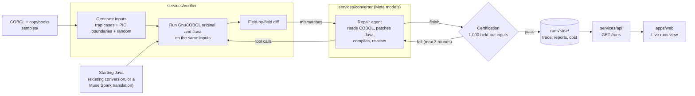

# Architecture (PLANNED)

> **Status: planned, not implemented.** This describes the target design for the hackathon build. Sections will be marked as implemented as modules land. Diagram: [architecture.drawio](architecture.drawio). Open it in [diagrams.net](https://app.diagrams.net) or the VS Code Draw.io Integration extension.

## Flow that runs today (implemented)
This is what works end to end right now on the synthetic `interest-accrual` sample. Everything below this section is the full target design.



1. **Inputs:** a synthetic COBOL program and a starting Java version, either an existing conversion or one translated by Muse Spark.
2. **Verify:** the verifier compiles both, runs them on the same generated inputs, and diffs every output field. GnuCOBOL is the source of truth.
3. **Repair:** the Muse Spark agent sees the mismatches and fixes the Java with tools (read, patch, compile, re-test). It can only edit the run's Java files.
4. **Certify:** when the agent finishes, the verifier re-tests on 1,000 inputs the agent never saw. If that fails, the agent gets another round (at most 3).
5. **Show:** the run (trace, before/after results, Java diff, tokens and cost) is saved under `runs/`, served by the API, and shown in the portal's **Live runs** view.

Not built yet: analyzer, Class Designer, SonarQube gate, starting runs from the browser, live streaming.

## Overview
Diocle is an "understand first, convert second" pipeline: **upload > analyze > design > convert > verify ⇄ repair > report**.

Deterministic tools understand and verify the code. Meta models design, convert and repair it. The model never certifies its own output: only execution against the original program compiled with GnuCOBOL does.

```
Portal (apps/web) ⇄ API orchestrator (services/api)
                         ├─ Layer 1 Analyzer   (deterministic)          → analysis-report
                         ├─ Layer 2 Converter  (Meta models)            → conversion-output
                         └─ Layer 3 Verifier   (GnuCOBOL + JDK + Sonar) → verification-report
                                    ▲                     │ diff mismatches + quality issues
                                    └── tool-using repair agent (≤3 rounds)
```

Run states (in `services/api`): `UPLOADED → ANALYZING → DESIGNING → CONVERTING → VERIFYING ⇄ REPAIRING (≤3) → CERTIFIED | NEEDS_REVIEW`. Each transition and agent step is streamed to the portal as a `run-events` SSE message.

## Model backends (CLAUDE.md rule 9)
| Mode | Model | Served by | Why |
|---|---|---|---|
| `hosted` | Muse Spark | Meta Model API | Default; strongest hosted model |
| `private` | Muse Spark Open (`meta-models/muse-spark-open-1026`) | Baseten or Modal (a deployment you control) | Regulated banks can't send source code to a shared cloud API. In private mode the code only goes to an endpoint you deploy. |

- The converter talks to both through one client interface. `MODEL_MODE` in `.env` picks the backend.
- Endpoints, model IDs and keys come from `.env`.
- Every call is logged as `{role, round, mode, tokens, latencyMs}`.
- Hard caps on calls per round and rounds per run (CLAUDE.md rule 10).
- Capabilities such as context size, native tool calling and structured output are **to be verified** per backend on Day 1.

## Layer 1: Analyzer (`services/analyzer`), deterministic, no LLM
- **Parser:** ProLeap COBOL parser (ANTLR4), wrapped in a small Java CLI that emits the AST/ASG as JSON. Fallback: a line-based Python parser limited to the constructs the samples use.
- **Topology graph:** CALL, COPY, EXEC SQL, EXEC CICS. SQL and CICS are graphed and flagged, not executed.
- **Data layout normalizer:**
  - COMP-3 → `BigDecimal` with explicit rounding.
  - REDEFINES → byte-buffer views.
  - OCCURS → 1-based arrays with bounds checks.
  - Emits a layout dictionary: level, PIC, usage, offset, length.
- **Risk rules:** money COMPUTE, ROUNDED, sign handling, REDEFINES, GO TO.
- **Output:** `contracts/analysis-report.schema.json`.

## Layer 2: Converter (`services/converter`), Meta models only
| Role | Input → output |
|---|---|
| 2A Class Designer | analysis report + layouts → packages, DTOs, class skeletons, COBOL→Java variable map |
| 2B Paragraph Translator | class map + variable map + one isolated paragraph → Java method |
| 2C Repair Agent | **tool-using agent** (below) |
| Rule Extractor | flagged paragraph → plain-English business rule |
| Edge-Case Test Designer | layouts + rules → semantic test inputs for the verifier |
| LLM-as-a-Judge | COBOL + Java → control-flow fidelity and idiomatic Java (1–7). **Advisory only.** |

All roles return schema-validated JSON. Generated Java depends on `services/converter/java-runtime`: `CobolDecimal`, `CobolArray`, `RedefinesBuffer`, and fixed-width record I/O.

## Repair Agent (2C): one agent, two kinds of failure
The repair step is an agent, not a fixed re-prompt. It handles both kinds of failure in the same loop:
1. **Equivalence failures:** `javac` errors, or field-level diffs against the GnuCOBOL oracle.
2. **Quality issues:** SonarQube Community findings on the generated Java (bugs, vulnerabilities, code smells).

**The rule that makes this trustworthy: a patch is accepted only if the code compiles, the differential tests still match the COBOL original, and the issue it targeted is gone.** A code-quality "fix" that silently changes behaviour is rejected. This replaces the manual cycle of fix, rebuild, rescan and re-check.

### Tools
| Tool | Implemented by | Returns |
|---|---|---|
| `compile_java(files)` | verifier | success, or `javac` errors with file and line |
| `run_differential_test(program, inputIds?)` | verifier | per-input match + field-level diffs (scale, padding, sign) |
| `get_quality_issues(file?)` | verifier (SonarQube Web API) | open issues with rule, severity, file, line, message |
| `lookup_field_layout(program, field)` | analyzer (report lookup) | level, PIC, usage, offset, length, REDEFINES/OCCURS |
| `read_cobol_paragraph(program, paragraph)` | analyzer (report lookup) | source text of one paragraph |
| `read_java_method(class, method)` | converter workspace | current Java source of one method |
| `patch_java(file, oldText, newText)` | converter workspace | applied / rejected (exact-match edit) |
| `finish(summary)` | converter | ends the round; triggers full re-verification (compile + diff + quality scan) |

The tool names, arguments and results are defined in `contracts/agent-tools.schema.json` (planned). The agent loop lives in `services/converter`. Each tool is implemented by the module that owns the capability, and `services/api` injects the tool executor into the agent.

### Guardrails
- At most 20 tool calls per round and 3 repair rounds. After that the run ends as `NEEDS_REVIEW`.
- Priority order: compile errors → equivalence diffs → quality issues by severity. Quality work never starts while outputs mismatch.
- `patch_java` can only touch the run's own Java workspace. No shell, no network, and no access to the COBOL sources or the oracle.
- **The agent cannot self-certify.** `finish` only requests verification. CERTIFIED is decided by the verifier.

### Observability
Every step emits an `agent-step` event: `{round, step, tool, argsSummary, resultSummary, rationale}`. Here `rationale` is the short explanation the model returns with each step. The portal shows a live agent trace next to the before/after diffs and the issues it cleared.

### Fallback
If a backend lacks native function calling, the same loop runs with a JSON "next action" response format: the model returns `{tool, args, rationale}`, and the converter executes the tool and feeds back the result. The tools, guardrails and trace stay the same.

## Layer 3: Verifier (`services/verifier`), Docker: GnuCOBOL + JDK 21
- **Inputs:** PIC boundary values + random values + model-designed edge cases. Each input is tagged with its source.
- **Oracle:** `cobc -x -std=ibm -I copybooks`, run on fixed-width input records.
- **Converted side:** the Spring Boot service, run on the same inputs as JSON.
- **Diff:** normalized field-by-field comparison of numeric scale, padding, sign and status codes.
- **Analytic checkers:** variable coverage, paragraph ↔ method alignment, hallucinated identifiers.
- **Quality gate (optional):** self-hosted SonarQube Community scan of the generated Java. Its issues feed the repair agent. It needs about 2–4 GB of RAM, so keep the server running ahead of the demo.
- **Output:** `contracts/verification-report.schema.json`, including the **equivalence certificate**: programs, inputs, pass rate, rounds, quality gate status, residual risks.

## Layer 4: Portal (`apps/web`) + API (`services/api`)
- **Portal:** split editor (COBOL ⇄ copybook vars ⇄ Java), topology graph, live run timeline, agent trace with repair-round diffs and cleared issues, model call log (with mode), and the equivalence scorecard/certificate.
- **API:** `POST /runs`, `GET /runs/{id}`, `GET /runs/{id}/events` (SSE). It orchestrates the layers and executes agent tools. It makes no LLM calls itself.

## Contracts (to be updated before implementation)
- `analysis-report`: + `layouts[]`; topology kinds `sql`, `cics`; findings + `paragraph`, `rule`.
- `conversion-output`: + `classDesign`, `modelCalls[]` (with `mode`), `javaServices[].round`.
- `verification-report`: + `inputSource`, `round`, `fieldDiffs[]`, `checks`, `qualityGate` {status, issues[]}, `judge`, `certificate`.
- New: `run-events.schema.json` (including `agent-step`) and `agent-tools.schema.json`.

## Principles
- Contracts first: modules communicate only via the schemas in `contracts/`.
- Meta models only inside the product (Muse Spark, Muse Spark Open).
- Verification is by differential execution, not by trusting model output, judge scores or lint results.
- Samples are synthetic only.
