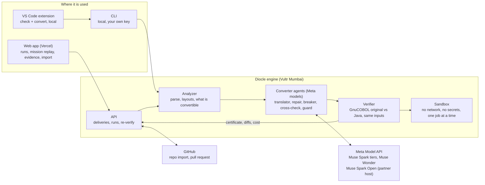

# Architecture

A simple map of how Diocle fits together. Details per module are in the READMEs under `services/`, `apps/web` and `editors/vscode`.

## How to read it
1. **Input.** A COBOL program arrives from the web app, the editor extension or the CLI. The analyzer parses it (copybooks, file layouts,
   calls, JCL) and decides what is convertible, with a stated reason when it is not.
2. **Agents.** Meta models translate it to Java; a breaker agent attacks code that already passed, a repair agent fixes what breaks, and
   an independent cross-check and a guard add a second look. Models only propose. **A model never certifies.**
3. **Verifier.** GnuCOBOL compiles and runs the original; the Java runs on the same generated inputs; the outputs are compared byte for
   byte, then again on fresh held-out inputs. Only this step can certify, and it runs inside the sandbox.
4. **Output.** A certificate (with the assurance label, diffs and cost) returns to the API and the web app, and can ship as a pull request
   that the target repository's own CI re-checks.

## Trust boundaries
- The sandbox has no network and no secrets, runs one job at a time as an unprivileged user in a private temporary space, and is killed
  and cleaned up after each job. It is where model-written Java and the original COBOL run.
- Visitor imports use the public path only: three programs, 1,500 lines each, a daily budget cap. Convert-anyway mode and pull requests
  need the admin passcode or the local CLI.
- Meta model keys live in `.env` on the machine that runs the converter. The web app and the editor extension never hold them.

## Not in the diagram yet
- **Convert-anyway and COBOL self-repair** (in the converter): programs the verifier cannot run are still translated and labelled
  `compiled-unverified`; a program whose original does not compile gets a tightly limited patch and the label
  `certified-against-repaired-cobol`. Only plain `certified` means the Java matched the original program.
- **Embedded SQL (DB2-style)** is being built on a branch and is not merged: it would add a database to the sandbox and compare final
  table contents as well as outputs. Until it is merged and deployed, programs with `EXEC SQL` are refused or labelled
  `compiled-unverified`. CICS and IMS are out of scope.
