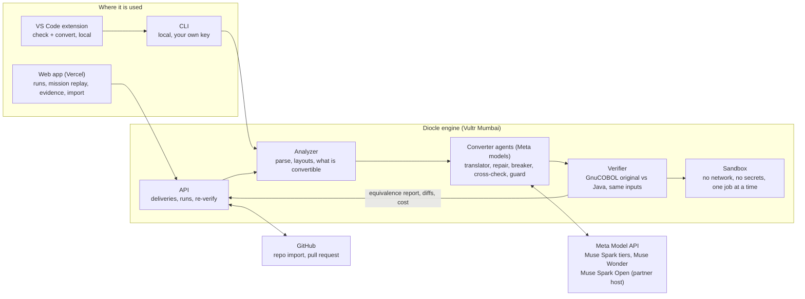

# Architecture

A simple map of how Diocle fits together. An editable draw.io version is in [`architecture-simple.drawio`](architecture-simple.drawio) (open it at app.diagrams.net or in the draw.io desktop app). Details per module are in the READMEs under `services/`, `apps/web` and `editors/vscode`.

## How to read it
1. **Input.** A COBOL program arrives from the web app, the editor extension or the CLI. The analyzer parses it (copybooks, file layouts,
   calls, JCL) and decides what is convertible, with a stated reason when it is not.
2. **Agents.** Meta models translate it to Java; a breaker agent attacks code that already passed, a repair agent fixes what breaks, and
   an independent cross-check and a guard add a second look. Models only propose. **A model never certifies.**
3. **Verifier.** GnuCOBOL compiles and runs the original; the Java runs on the same generated inputs; the outputs are compared byte for
   byte, then again on fresh held-out inputs. Only this step can certify, and it runs inside the sandbox.
4. **Output.** A equivalence report (with the assurance label, diffs and cost) returns to the API and the web app, and can ship as a pull request
   that the target repository's own CI re-checks.

## Trust boundaries
- The sandbox has no network and no secrets, runs one job at a time as an unprivileged user in a private temporary space, and is killed
  and cleaned up after each job. It is where model-written Java and the original COBOL run.
- Visitor imports use the public path only: three programs, 1,500 lines each, a daily budget cap. Convert-anyway mode and pull requests
  need the admin passcode or the local CLI.
- Meta model keys live in `.env` on the machine that runs the converter. The web app and the editor extension never hold them.

## Not in the diagram yet
- **Convert-anyway and COBOL self-repair** (in the converter): programs the verifier cannot run are still translated and labelled
  `compiled-unverified`; a program whose original does not compile gets a tightly limited patch and the label
  `certified-against-repaired-cobol`. Only plain `certified` means the Java matched the original program.
- **Embedded SQL (DB2-style)** is merged and deployed for a named subset (`db2-subset-1`): the COBOL goes through Diocle's own small precompiler to a C shim over SQLite, the Java uses JDBC through the verifier's `DioSql` class, and final table contents are compared as well as outputs. SQLite is a stand-in, not DB2. Programs outside the subset are refused or labelled `compiled-unverified`. CICS and IMS are out of scope. The delivered Java needs `DioSql.java` to compile on its own (the whole-repository check and generated CI add it).
- **Keyed files (VSAM-style)**, subset `ksds-subset-1`: the verifier seeds identical keyed files and compares final contents on GnuCOBOL's Berkeley DB indexed handler, not IBM VSAM. Experimental: not exercised on the live site.
- **Verification strength and debugging aids** (verifier, no model): mutation testing (`/runs/{id}/mutation`) seeds small faults into a copy of the Java to see whether the inputs notice; the smallest-reproducer minimizer cuts a failing input down and saves a regression case (skipped when a sandbox is configured, so empty on the live engine).
- **Whole-repository build check** (`buildcheck`): compiles all delivered programs together and checks copybook drift and CALL interfaces; it runs in deliveries and in the generated CI. Experimental: not checked live.
- **Create-target mode** (local or admin only): a delivery can create its own private repository and open the pull request into it.
- **Voice question** (`/asks`): a bundled clip is transcribed by Muse Voice Transcribe, a Muse Spark model proposes claims, and GnuCOBOL confirms or refutes them in the sandbox. Models propose; the run decides.
